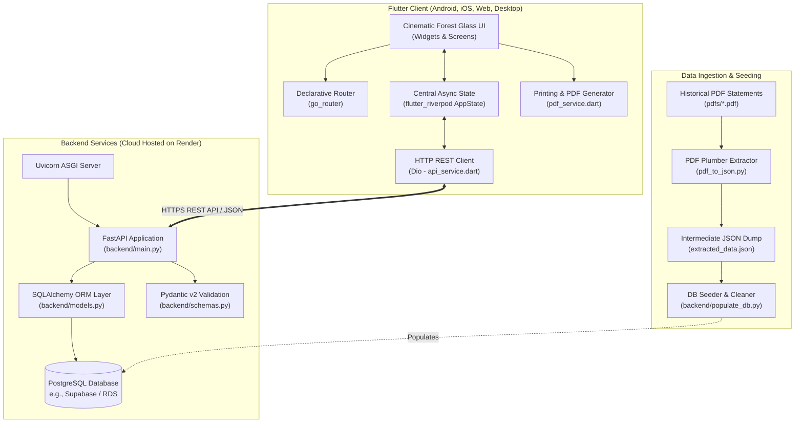
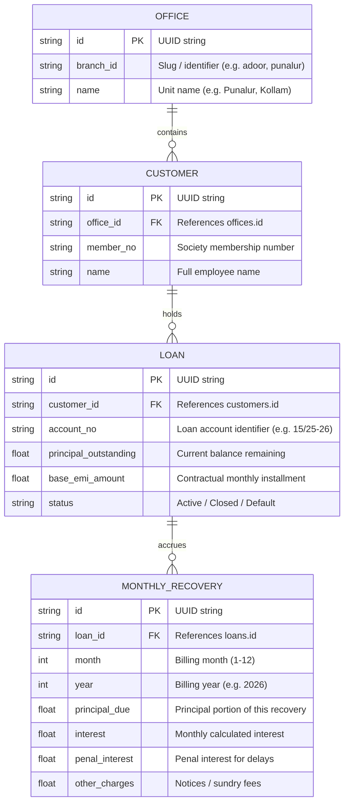
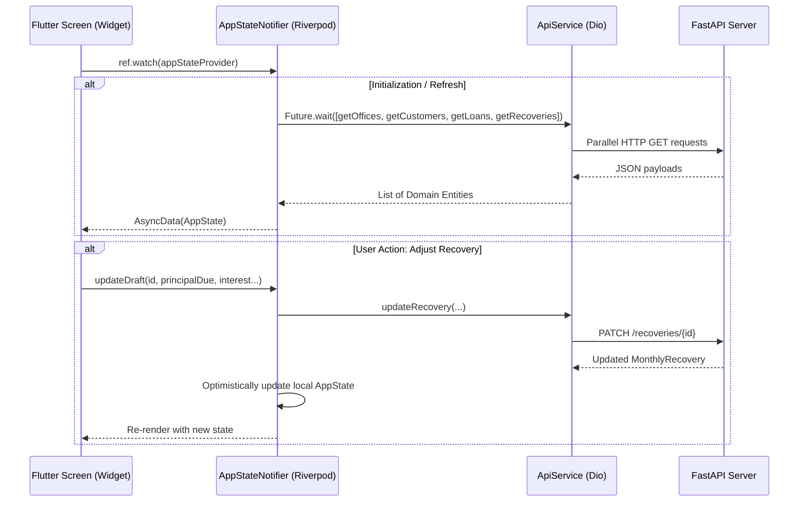
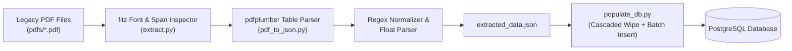

# System Architecture & Technical Documentation
## Loan Recovery & Ledger Management System

> **Document Version:** 1.0.0  
> **Target System:** Kollam District Postal Employees Welfare & Housing Co-operative Society Ltd. No. Q1446  
> **Statutory Framework:** Section 37(2), Rule 52 of the Kerala Co-operative Societies Act, 1969  
> **Last Updated:** November 2026

---

## Table of Contents
1. [Executive Summary & System Purpose](#1-executive-summary--system-purpose)
2. [High-Level Architecture](#2-high-level-architecture)
3. [Technology Stack](#3-technology-stack)
4. [Database Architecture & Data Models](#4-database-architecture--data-models)
5. [Core Business Logic & Computational Rules](#5-core-business-logic--computational-rules)
6. [API Specification & Backend Design](#6-api-specification--backend-design)
7. [Frontend Architecture & State Management](#7-frontend-architecture--state-management)
8. [PDF Ingestion & Historical Extraction Engine](#8-pdf-ingestion--historical-extraction-engine)
9. [Official Statutory PDF Generation Engine](#9-official-statutory-pdf-generation-engine)
10. [Repository File Map](#10-repository-file-map)
11. [Deployment, Environment & Configuration](#11-deployment-environment--configuration)
12. [Architectural Recommendations & Roadmap](#12-architectural-recommendations--roadmap)

---

## 1. Executive Summary & System Purpose

The **Loan Recovery & Ledger Management System** is a full-stack, cross-platform financial operations platform designed specifically for cooperative employee credit and housing societies.

### Core Problems Solved
1. **Dispersed Branch Ledgers:** Cooperative societies often manage members across multiple Head Post Offices (HPOs) or regional employer branches (e.g., Punalur, Adoor, Alappuzha, Kollam).
2. **Monthly Demand Generation:** Every month, the society must compute monthly loan deductions (Principal Due, Interest, Penal Interest, Notices, and Sundry Charges) for hundreds of active loans across multiple employee members.
3. **Statutory Salary Deductions:** Formal monthly demand schedules must be submitted to the respective Post Masters / Disbursing Officers under **Section 37(2), Rule 52 of the Kerala Co-operative Societies Act 1969**, demanding deductions at source from employee salaries and subsequent remittance via Demand Draft or Pay Order.
4. **Digitization of Legacy Scans:** The platform includes reverse-engineering utilities to ingest legacy, scanned, or tabular PDF recovery schedules into normalized relational databases.

---

## 2. High-Level Architecture

The system follows a modern decoupled client-server architecture:



---

## 3. Technology Stack

### 3.1. Frontend (Mobile, Web, Desktop)
| Category | Technology | Version | Purpose |
| :--- | :--- | :--- | :--- |
| **Framework** | Flutter / Dart SDK | `^3.10.7` | Single codebase targeting Android, iOS, Web, macOS, Linux, Windows |
| **State Management** | `flutter_riverpod` | `^3.3.1` | Asynchronous state management (`AsyncNotifier`), optimistic updates, cache invalidation |
| **Routing** | `go_router` | `^17.2.0` | Declarative, path-parameter-based deep-linking and navigation |
| **HTTP Client** | `dio` | `^5.9.2` | Network requests with configurable base URL, timeouts, and JSON serialization |
| **Visual Design** | Custom Glassmorphism | Custom | `BackdropFilter`, frosted glass blur (`ImageFilter.blur`), custom borders and tints |
| **Styling & Fonts** | Custom Embedded Calibri | - | Bundled Calibri Regular & Calibri Bold for pixel-perfect statutory alignment |
| **PDF & Printing** | `pdf` & `printing` | `^3.12.0`, `^5.14.3` | Direct rendering, table multi-page pagination, native print & share sheets |
| **ID & Formatting** | `uuid`, `intl` | `^4.5.3`, `^0.20.2` | Client-side UUID generation and localized number/date formatting |

### 3.2. Backend (API & Business Services)
| Category | Technology | Purpose |
| :--- | :--- | :--- |
| **Language** | Python 3.9+ | Backend runtime |
| **Web Framework** | FastAPI | High-performance asynchronous API endpoints with auto OpenAPI documentation |
| **ASGI Web Server**| Uvicorn (`uvicorn[standard]`) | Production ASGI server with process management |
| **ORM** | SQLAlchemy | Object Relational Mapping, declarative models, session pooling, foreign key constraints |
| **Data Validation** | Pydantic v2 | Strict request/response schema modeling, JSON parsing, serialization |
| **Database Adapter**| `psycopg2-binary` | PostgreSQL database connection driver |
| **Configuration** | `python-dotenv` | Environment variable isolation (`.env` & hosting config) |
| **Deployment** | Render (`Procfile`) | Cloud hosting container runtime |

### 3.3. Data Ingestion & Extraction Pipeline
| Category | Technology | Purpose |
| :--- | :--- | :--- |
| **PDF Extraction** | `pdfplumber` | Precise cell coordinate extraction, whitespace stripping, multi-line row parsing |
| **Font & Geometry**| `PyMuPDF` (`fitz`) | Coordinate bounding-box inspection, font size detection, table column boundary analysis |
| **Storage** | `json` | Structured intermediate representation (`extracted_data.json`) |

---

## 4. Database Architecture & Data Models

### 4.1. Entity Relationship (ER) Diagram



### 4.2. Database Tables Specification

#### 1. `offices`
Represents an administrative unit, head post office, or branch.
- `id` (`VARCHAR`, PK): Unique UUID.
- `branch_id` (`VARCHAR`): Normalized slug (e.g., `punalur`, `kollam`).
- `name` (`VARCHAR`, NOT NULL): Official display name.

#### 2. `customers`
Represents an individual employee member of the cooperative society.
- `id` (`VARCHAR`, PK): Unique UUID.
- `office_id` (`VARCHAR`, FK $\to$ `offices.id`): Associated branch.
- `member_no` (`VARCHAR`, NOT NULL): Society membership identifier.
- `name` (`VARCHAR`, NOT NULL): Full legal name of the employee.

#### 3. `loans`
Represents a loan contract issued to a member.
- `id` (`VARCHAR`, PK): Unique UUID.
- `customer_id` (`VARCHAR`, FK $\to$ `customers.id`): Borrower reference.
- `account_no` (`VARCHAR`, NOT NULL): Loan account number (format `XX/YY-ZZ`).
- `principal_outstanding` (`FLOAT`, default `0.0`): Remaining loan balance.
- `base_emi_amount` (`FLOAT`, default `0.0`): Fixed agreed EMI target.
- `status` (`VARCHAR`, default `'Active'`): Loan status flag.

#### 4. `monthly_recoveries`
Represents the monthly billing ledger entry / recovery demand schedule for a loan.
- `id` (`VARCHAR`, PK): Unique UUID.
- `loan_id` (`VARCHAR`, FK $\to$ `loans.id`): Associated loan.
- `month` (`INTEGER`, NOT NULL): 1 to 12.
- `year` (`INTEGER`, NOT NULL): Fiscal calendar year.
- `principal_due` (`FLOAT`, default `0.0`): Principal component to deduct.
- `interest` (`FLOAT`, default `0.0`): Interest component to deduct.
- `penal_interest` (`FLOAT`, default `0.0`): Surcharge / penalty for arrears.
- `other_charges` (`FLOAT`, default `0.0`): Legal notices / postal fees.
- **Virtual Property:** $\text{total\_recovered} = \text{principal\_due} + \text{interest} + \text{penal\_interest} + \text{other\_charges}$.

---

## 5. Core Business Logic & Computational Rules

### 5.1. Automated Monthly Draft Generation
The core computational engine resides in `POST /recoveries/generate`.

#### Calculation Formulas:
1. **Interest Calculation:**
   $$\text{Interest} = \operatorname{round}(\text{principal\_outstanding} \times 0.01, 2)$$
   *Rule:* Interest is charged at **1% per month** (equivalent to 12% per annum simple rate on outstanding principal balance).

2. **Principal Due Calculation:**
   $$\text{Principal Due} = \operatorname{round}(\text{base\_emi\_amount} - \text{Interest}, 2)$$

3. **Negative Principal Edge-Case Protection:**
   In cases where the contractual base EMI is less than the calculated monthly interest:
   $$\text{if } \text{Principal Due} < 0 \implies \begin{cases} \text{Principal Due} = \text{base\_emi\_amount} \\ \text{Interest} = 0.0 \end{cases}$$

4. **Default Charges:**
   $$\text{Penal Interest} = 0.0, \quad \text{Other Charges} = 0.0$$

5. **Idempotency Guarantee:**
   Before creating a draft, the system verifies whether a `MonthlyRecovery` record already exists for the tuple `(loan_id, month, year)`. Existing records are untouched, preventing duplicate demands.

### 5.2. Manual Adjustment Logic (`PATCH /recoveries/{recovery_id}`)
Society clerks can manually override any component of a generated recovery:
- `principal_due`
- `interest`
- `penal_interest`
- `other_charges`

The frontend immediately recalculates the composite total:
$$\text{Total Deducted} = \text{Principal Due} + \text{Interest} + \text{Penal Interest} + \text{Other Charges}$$

---

## 6. API Specification & Backend Design

All endpoints are hosted at `https://emi-calculator-q4hs.onrender.com/` (or `http://localhost:8000` during local development). CORS is enabled for all origins (`*`) with credentials support.

### 6.1. Endpoint Matrix

| Method | Path | Description | Query / Body Params | Response |
| :--- | :--- | :--- | :--- | :--- |
| `GET` | `/` | Health check | None | `{"message": "..."}` |
| `GET` | `/offices/` | List all registered offices/branches | None | `List[Office]` |
| `POST` | `/offices/` | Register a new office/branch | Body: `OfficeBase` | `Office` |
| `DELETE` | `/offices/{office_id}` | Delete an office | Path: `office_id` | Status 204 |
| `GET` | `/customers/` | List customers (optional office filter) | Query: `office_id` (optional) | `List[Customer]` |
| `POST` | `/customers/` | Register a new customer | Body: `CustomerBase` | `Customer` |
| `DELETE` | `/customers/{customer_id}`| Delete a customer | Path: `customer_id` | Status 204 |
| `GET` | `/loans/` | List loans (optional customer filter) | Query: `customer_id` (optional) | `List[Loan]` |
| `POST` | `/loans/` | Create a new loan account | Body: `LoanBase` | `Loan` |
| `DELETE` | `/loans/{loan_id}` | Delete a loan account | Path: `loan_id` | Status 204 |
| `GET` | `/recoveries/` | List recoveries | Query: `month`, `year` | `List[MonthlyRecovery]` |
| `POST` | `/recoveries/` | Create a single recovery record | Body: `MonthlyRecoveryBase` | `MonthlyRecovery` |
| `POST` | `/recoveries/generate`| Generate batch monthly drafts | Query: `month`, `year`, `office_id` | `{"message": "X drafts generated..."}` |
| `PATCH` | `/recoveries/{recovery_id}`| Update specific recovery line | Query: `principal_due`, `interest`, `penal_interest`, `other_charges` | `MonthlyRecovery` |

---

## 7. Frontend Architecture & State Management

### 7.1. Riverpod Reactive Architecture
The Flutter frontend uses an immutable state container managed by an `AsyncNotifier`.



### 7.2. Navigation Hierarchy (`go_router`)
- `/` $\to$ **`HomeDashboardScreen`**: Overview of all units/branches, employee counts, quick add/wipe unit.
- `/branch/:id` $\to$ **`BranchDetailsScreen`**: Roster of members in that unit, total loan exposure, member creation/deletion.
- `/customer/:id` $\to$ **`CustomerProfileScreen`**: Individual member exposure, active loan account cards, new loan initialization.
- `/branch/:id/drafts` $\to$ **`MonthlyDraftsScreen`**: Master recovery ledger for current month/year, inline draft generation, itemized EMI adjustment dialog.
- `/branch/:id/preview/:month/:year` $\to$ **`PdfPreviewScreen`**: Interactive high-resolution print/export preview.

### 7.3. UI & Design System: "Cinematic Forest Glass"
The application uses a distinctive dark glassmorphic visual language:
- **Scaffold Backdrop:** Darkened cinematic nature photography (`assets/atmospheric_nature_bg.png`) layered behind a 50% opacity neutral glass scrim.
- **Glass Surfaces (`GlassCard`, `GlassPill`):** Built via Flutter's `BackdropFilter` and `ImageFilter.blur(sigmaX: 20, sigmaY: 20)` with high-contrast semi-transparent white borders (`0x66FFFFFF`) and soft white inner fills (`0x1AFFFFFF`).
- **Typography:** Custom Calibri font family with -0.5px letter spacing on titles and uppercase micro-labels for financial numbers.

---

## 8. PDF Ingestion & Historical Extraction Engine

To transition from legacy PDF records without manual data entry, the system features a dedicated Python ingestion engine:



### Key Parsing Techniques in `pdf_to_json.py`:
1. **Branch Detection:** Regex scan of header text (`The Post Master <Branch> HPO`) combined with filename matching.
2. **Table Header Alignment:** Dynamic scan for `Memo No.` or `No.` row to determine table start index.
3. **Multi-line Account Unfolding:** When a single member has multiple active loans listed within a single cell separated by newlines (`\n`), the script splits each sub-row, normalizes comma-separated currency values, and generates discrete loan entries.
4. **Relational Population (`backend/populate_db.py`):**
   - Cascaded deletion in safe foreign key order: `MonthlyRecovery` $\to$ `Loan` $\to$ `Customer` $\to$ `Office`.
   - Generates deterministic foreign key associations using client UUIDs.
   - Preserves member uniqueness per office unit.

---

## 9. Official Statutory PDF Generation Engine

The PDF generation module (`lib/services/pdf_service.dart`) produces legal, statutory-compliant demand schedules for submission to the postal department.

### 9.1. Statutory Legal Text & Citation
Every document is styled after official notifications pursuant to:
> *"As per Sub – Section (2) of section 37 , Rule 52 of the Kerala Co-Operative Societies Act 1969, We request you to be good enough to deduct from the salary of the following employees of your Bank the amounts noted against each and remit to us towards their loan accounts for the month and return the duplicate along with your D.D/pay order"*

### 9.2. Exact Table Geometry & Typography
The PDF engine matches standard Indian banking/cooperative recovery schedules:
- **Paper Format:** A4 Portrait, with $14.16\text{pt}$ horizontal and $30.0\text{pt}$ vertical margins.
- **Fonts:** Calibri (Regular and Bold) loaded from Flutter bundle assets.
- **Table Column Structure (11 Columns):**

| Col # | Header Title | Width (pt) | Content / Value |
| :---: | :--- | :---: | :--- |
| **0** | Memo No. | 35.0 | Member Number |
| **1** | Name | 78.0 | Employee Full Name |
| **2** | Account No. | 56.0 | Loan Account Number |
| **3** | Principal Outstanding | 63.0 | Total remaining loan principal |
| **4** | Principal Due | 49.0 | Principal portion for this month |
| **5** | EMI | 35.0 | Principal Due + Interest |
| **6** | Interest | 42.0 | Monthly interest charge |
| **7** | Penal Int | 35.0 | Penalty amount (or `-`) |
| **8** | Notice | 36.0 | Notice fee (default `-`) |
| **9** | Others | 34.0 | Sundry charges (or `-`) |
| **10**| Total amount to be recovered | 55.0 | Grand total deduction |

---

## 10. Repository File Map

```
Loan_ledger/
├── backend/                        # Python FastAPI Backend
│   ├── .env                        # Local database credentials (ignored)
│   ├── .gitignore                  # Backend ignore rules
│   ├── Procfile                    # Render deployment command
│   ├── requirements.txt            # Python dependencies (FastAPI, SQLAlchemy, etc.)
│   ├── database.py                 # SQLAlchemy engine, session maker, get_db dependency
│   ├── models.py                   # SQLAlchemy DB entities (Office, Customer, Loan, MonthlyRecovery)
│   ├── schemas.py                  # Pydantic validation schemas
│   ├── main.py                     # API route declarations and calculation logic
│   └── populate_db.py              # Ingestion runner: extracted_data.json -> PostgreSQL
│
├── lib/                            # Flutter Frontend Application
│   ├── main.dart                   # Application bootstrap and GoRouter route declarations
│   ├── theme/
│   │   └── app_theme.dart          # Color tokens, typography, dark theme definition
│   ├── models/                     # Dart domain data models (JSON serialization)
│   │   ├── branch.dart             # Branch entity model
│   │   ├── office.dart             # Office entity model
│   │   ├── customer.dart           # Customer entity model
│   │   ├── loan.dart               # Loan entity model
│   │   └── monthly_recovery.dart   # Monthly recovery entity model
│   ├── data/
│   │   ├── api_service.dart        # Dio client handling all backend API communications
│   │   ├── data_providers.dart     # Riverpod AppState and AppStateNotifier
│   │   └── dummy_data.dart         # Fallback / mock data for standalone testing
│   ├── services/
│   │   └── pdf_service.dart        # Statutory multi-page PDF generation engine
│   ├── widgets/
│   │   ├── background_scaffold.dart # Cinematic forest background with dark glass overlay
│   │   └── glass_card.dart         # GlassCard, GlassPill, GlassErrorPlaceholder, GlassLoading
│   └── screens/
│       ├── splash_loading_screen.dart   # Animated initialization splash
│       ├── home_dashboard_screen.dart   # Unit selection grid & unit management
│       ├── branch_details_screen.dart   # Unit members list and financial summaries
│       ├── customer_profile_screen.dart # Member profile and active loan accounts
│       ├── monthly_drafts_screen.dart   # Interactive recovery ledger and adjustment dialogs
│       ├── pdf_preview_screen.dart      # In-app print, PDF share and preview
│       ├── customers_screen.dart        # Supplementary customer directory
│       └── dashboard_screen.dart        # Desktop responsive shell with glass sidebar
│
├── assets/                         # Static Assets
│   ├── atmospheric_nature_bg.png   # Full-bleed dark forest background image
│   ├── abstract_bg.png             # Alternative UI background variant
│   └── fonts/                      # Statutory TrueType Fonts
│       ├── calibri.ttf             # Calibri Regular
│       └── calibrib.ttf            # Calibri Bold
│
├── pdfs/                           # Sample Statutory Scans & Historical Schedules
│   ├── Document society_adoor_mar.pdf
│   ├── Document society_alappuzha_mar.pdf
│   ├── Document society_kollam_mar.pdf
│   └── Document society_Sept_punalur.pdf
│
├── pdf_to_json.py                  # Script: Extracts tabular data from pdfs/ to JSON
├── extract.py                      # Diagnostic script: Inspects PDF font boxes and coordinates
├── extracted_data.json             # Normalized JSON dump of parsed PDF data
├── pubspec.yaml                    # Flutter project specification and dependencies
└── requirements.txt                # Root Python environment specification
```

---

## 11. Deployment, Environment & Configuration

### 11.1. Backend Configuration
The backend requires a PostgreSQL database URL. In `backend/.env`:
```ini
DATABASE_URL=postgresql://<username>:<password>@<host>:<port>/<dbname>
```
*Note: When deploying on Render or cloud providers, set `DATABASE_URL` in the environment settings dashboard.*

### 11.2. Backend Deployment Command
The service runs via the `Procfile`:
```bash
web: PYTHONPATH=. uvicorn main:app --host 0.0.0.0 --port $PORT
```

### 11.3. Frontend API Base URL
The API endpoint is declared in `lib/data/api_service.dart`:
```dart
final String _baseUrl = 'https://emi-calculator-q4hs.onrender.com/';
```
For local testing via Android emulator or USB debugging:
- Use `http://10.0.2.2:8000/` (Android Studio Emulator).
- Use `adb reverse tcp:8000 tcp:8000` with `http://127.0.0.1:8000/` for physical devices over USB.

---

## 12. Architectural Recommendations & Roadmap

1. **Authentication & Role-Based Access Control (RBAC):**
   - Add OAuth2 / JWT bearer authentication to FastAPI.
   - Establish roles: `Clerk` (can view and edit draft recoveries) vs `Auditor / Admin` (can wipe branches, approve schedules).
2. **Database Migrations:**
   - Integrate **Alembic** for schema migrations to supersede `models.Base.metadata.create_all(bind=engine)`.
3. **Draft Locking & Finalization:**
   - Introduce a `status` field on `MonthlyRecovery` (`Draft`, `Approved`, `Dispatched`, `Remitted`). Once submitted, locks further editing.
4. **Automated Remittance Reconciliation:**
   - Build a reconciliation intake endpoint where bank DD / Pay Order credit advices can be uploaded and automatically matched against member ledger balances.
5. **Pagination & Query Optimization:**
   - As membership scales, add offset/limit pagination on `/customers/` and `/loans/` endpoints to optimize payload sizes and memory consumption.

