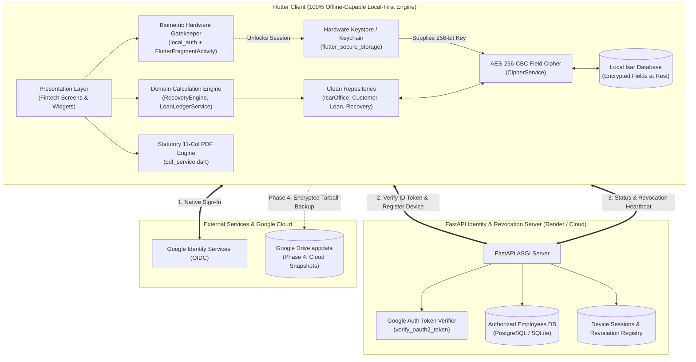
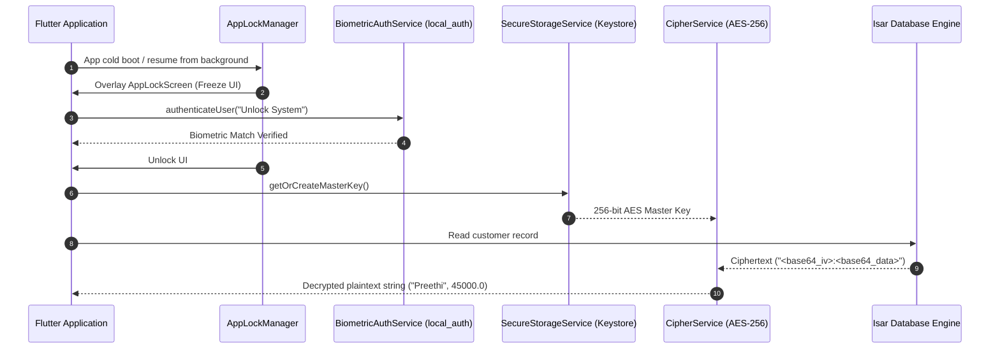
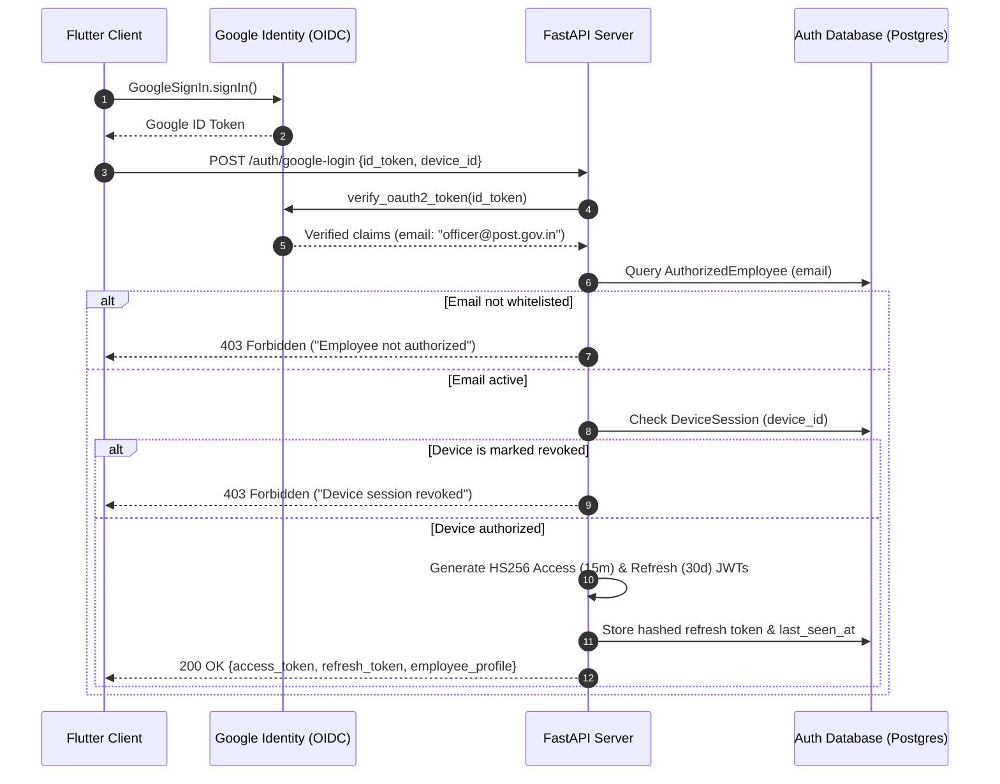

# Technical Documentation & System Roadmap
## Loan Recovery & Ledger Management System
**Target System:** Kollam District Postal Employees Welfare & Housing Co-operative Society Ltd. No. Q1446  
**Statutory Framework:** Section 37(2), Rule 52 of the Kerala Co-operative Societies Act, 1969  
**Platform Architecture:** Local-First, Offline-Capable, Zero-Trust Mobile/Desktop Financial Application with FastAPI Identity & Revocation Gateway  
**Primary Tech Stack:** Flutter (Dart 3), Riverpod 3, Isar v3 (AES-256 Encrypted), GoRouter, Python 3.9+ (FastAPI, SQLAlchemy, PyMuPDF, pdfplumber)  

---

## Table of Contents
1. [Executive Summary & Real-World Domain Problem](#1-executive-summary--real-world-domain-problem)
2. [High-Level Architecture & Technical Evolution](#2-high-level-architecture--technical-evolution)
3. [Core Business Logic & Financial Computational Rules](#3-core-business-logic--financial-computational-rules)
4. [Complete Status Matrix (Implemented vs. Planned)](#4-complete-status-matrix-implemented-vs-planned)
5. [In-Depth Breakdown of Implemented Features](#5-in-depth-breakdown-of-implemented-features)
   - [5.1. Cryptographic Security & Hardware Enclave](#51-cryptographic-security--hardware-enclave)
   - [5.2. Local Encrypted Database & Clean Architecture Repositories](#52-local-encrypted-database--clean-architecture-repositories)
   - [5.3. Authentication Gateway & Remote Session Revocation](#53-authentication-gateway--remote-session-revocation)
   - [5.4. Minimal Fintech UI/UX Design System](#54-minimal-fintech-uiux-design-system)
   - [5.5. Official Statutory PDF Generation Engine](#55-official-statutory-pdf-generation-engine)
   - [5.6. Legacy Tabular PDF Ingestion & Seeding Engine](#56-legacy-tabular-pdf-ingestion--seeding-engine)
   - [5.7. Automated Test Suite & Quality Assurance](#57-automated-test-suite--quality-assurance)
6. [In-Depth Breakdown of Planned Features (Roadmap & Backlog)](#6-in-depth-breakdown-of-planned-features-roadmap--backlog)
   - [6.1. Google Drive Private Cloud Backup & Disaster Recovery (Phase 4)](#61-google-drive-private-cloud-backup--disaster-recovery-phase-4)
   - [6.2. Code-Gated P2P Local Handover Protocol (Phase 5)](#62-code-gated-p2p-local-handover-protocol-phase-5)
   - [6.3. Production Cloud Credentials & Play Store Keystore Enrollment](#63-production-cloud-credentials--play-store-keystore-enrollment)
   - [6.4. Granular RBAC (Auditor vs. Officer vs. Admin)](#64-granular-rbac-auditor-vs-officer-vs-admin)
   - [6.5. Recovery Approval, Ledger Freezing & DD Remittance Reconciliation](#65-recovery-approval-ledger-freezing--dd-remittance-reconciliation)
   - [6.6. Database Migrations with Alembic](#66-database-migrations-with-alembic)
7. [Repository File & Directory Structure](#7-repository-file--directory-structure)
8. [Master Interview & System Design Cheat Sheet](#8-master-interview--system-design-cheat-sheet)

---

## 1. Executive Summary & Real-World Domain Problem

### 1.1 The Organization & Legal Mandate
The **Kollam District Postal Employees Welfare & Housing Co-operative Society Ltd. No. Q1446** operates across multiple Head Post Offices (HPOs) and sub-post offices in the southern region of Kerala, India (including Punalur, Adoor, Alappuzha, Kollam, etc.). The society provides welfare and housing credit facilities to postal department employees.

Under **Section 37(2), Rule 52 of the Kerala Co-operative Societies Act, 1969**, the society is legally empowered to recover monthly loan installments directly from employees' government salary disbursements. Every month, the society must generate and serve formal demand recovery schedules to each respective **Postmaster / Disbursing Officer**. The Postmaster deducts the demanded amounts at source from payroll and remits the bulk sum back to the society via Demand Draft (DD) or Pay Order, returning a verified duplicate schedule.

### 1.2 Core Operational Challenges Solved
1. **Dispersed Regional Units:** Member employees are spread across distinct postal divisions. Each unit requires independent ledger tracking, member rosters, and recovery schedules.
2. **Complex Monthly Demand Formulation:** Each member may hold multiple active loan accounts. Monthly recovery consists of a principal installment, simple interest calculated on the reducing balance, potential penal interest for arrears, and sundry/notice fees.
3. **Statutory Document Precision:** The postal accounts department requires an exact, non-standard **11-column statutory schedule** with specific legal citations. Any formatting defect or calculation discrepancy leads to rejection of salary deductions.
4. **Historical Legacy Ingestion:** Previous records existed only as complex multi-page PDF statements with nested accounts per cell, requiring reverse-engineering and digitizing into normalized databases without data loss.
5. **Field-Level Operational Security (Zero-Trust):** Field recovery officers operate on mobile devices in remote branch offices where internet connectivity is intermittent. The data contains confidential financial records (loan balances, salary deductions, employee identity). The system must run **100% offline**, encrypt all sensitive data at rest with hardware-backed keys, and protect against lost/stolen devices or rogue employees.

---

## 2. High-Level Architecture & Technical Evolution

### 2.1 The Architectural Evolution
The project originally began as a conventional **Client-Server REST model** (FastAPI backend + PostgreSQL on Render + Flutter client via Dio). However, field realities in cooperative postal operations necessitated a strategic architectural pivot:

- **Original Architecture:** Client-Server. Every ledger read, draft generation, and member lookup required network requests to a cloud database. In rural post offices without connectivity, officers were blocked from working.
- **Current Architecture (Local-First Zero-Trust):**
  - **100% On-Device Engine:** All ledger operations, interest computations, customer management, and statutory PDF generation execute locally using an embedded, high-performance **Isar Community Database**.
  - **Transparent AES-256 Field Encryption:** Data at rest is encrypted using AES-256-CBC before hitting the local disk. Keys reside in the device hardware security enclave (Keychain/Keystore).
  - **Lightweight Cloud Identity Gateway:** The Python/FastAPI backend was decoupled from daily ledger transactions and repurposed into a specialized **Identity, Authentication & Session Revocation Gateway**. It verifies Google OIDC tokens against an authorized employee whitelist, issues custom JWTs, and provides an instant remote kill-switch (device revocation).

### 2.2 System Architecture Diagram



---

## 3. Core Business Logic & Financial Computational Rules

### 3.1 Financial Formulas & Recovery Rules
The cooperative society operates under specific interest calculation conventions that govern how monthly salary recovery demands are computed.

#### Rule 1: Constant Principal Installment (`baseEmiAmount`)
In this society's operational terminology, `baseEmiAmount` represents the **contractual monthly principal installment** (not a standard annuity EMI):
$$\text{Principal Due} = \min(\text{base\_emi\_amount}, \text{principal\_outstanding})$$
*If the remaining principal balance is less than the base installment, the principal due is capped at the remaining balance.*

#### Rule 2: Reducing Balance Interest Calculation
Interest is levied on the **net remaining balance** after deducting the current month's principal installment:
1. Calculate reduced balance:
   $$\text{Reduced Outstanding} = \text{principal\_outstanding} - \text{Principal Due}$$
2. Apply statutory simple interest:
   $$\text{Interest} = \operatorname{round}(\text{Reduced Outstanding} \times 0.01, 2)$$
   *(Equivalent to 12.0% per annum simple interest calculated monthly at 1.0% on the reduced balance).*

#### Rule 3: Composite Recovery Demand
The total amount demanded from the employee's salary is:
$$\text{Total Recovered} = \text{Principal Due} + \text{Interest} + \text{Penal Interest} + \text{Other Charges}$$
- **Penal Interest:** Default is `0.0`. Manually adjusted if arrears exist.
- **Other Charges:** Default is `0.0`. Applied for notice issuance, postal fees, or legal stamp charges.

#### Rule 4: Idempotency Guarantee
The batch draft generation routine (`RecoveryEngine.generateDrafts`) iterates over all active loans within a branch. For each loan, it verifies whether a `MonthlyRecovery` record already exists for the composite tuple `(loan_id, month, year)`. If a draft already exists, it is untouched, preventing double-billing.

#### Rule 5: Line-Item Manual Overrides
Society clerks can manually adjust any component of a generated recovery line (`principalDue`, `interest`, `penalInterest`, `otherCharges`) via `adjustRecoveryDraft`. The composite total recalculates instantaneously and updates the reactive Riverpod state.

---

## 4. Complete Status Matrix (Implemented vs. Planned)

| Module / Capability | Feature Detail | Current Status | Verification / Artifact |
| :--- | :--- | :---: | :--- |
| **Financial Engine** | 12% p.a. Reducing balance interest + principal calculation | **IMPLEMENTED** | `RecoveryEngine.dart`, unit tests in `recovery_engine_test.dart` |
| **Financial Engine** | Idempotent monthly draft generation per unit | **IMPLEMENTED** | `generateDrafts()`, tested in `isar_database_test.dart` |
| **Financial Engine** | Line-item recovery overrides (penal, interest, notice) | **IMPLEMENTED** | `adjustRecoveryDraft()`, tested with live UI |
| **Local Database** | Embedded Isar Community DB with 4 collections | **IMPLEMENTED** | `lib/data/local/schemas/`, schemas generated via build_runner |
| **Local Database** | Clean Architecture Repository Pattern (`IOfficeRepository`, etc.) | **IMPLEMENTED** | `lib/domain/repositories/`, in-memory & Isar repositories |
| **Local Database** | Cascading deletions (Office $\to$ Customer $\to$ Loan $\to$ Recovery) | **IMPLEMENTED** | `LoanLedgerService.deleteOfficeCascade()` |
| **Security & Enclave** | AES-256-CBC field-level encryption with randomized IVs | **IMPLEMENTED** | `CipherService.dart`, tested in `cipher_service_test.dart` |
| **Security & Enclave** | Hardware Keystore/Keychain master key generation & storage | **IMPLEMENTED** | `SecureStorageService.dart`, tested in `secure_storage_service_test.dart` |
| **Security & Enclave** | Biometric gatekeeper (Fingerprint / FaceID / Device PIN) | **IMPLEMENTED** | `BiometricAuthService.dart`, `local_auth` integration |
| **Security & Enclave** | AppLifecycleListener auto-locking on backgrounding | **IMPLEMENTED** | `AppLockManager.dart`, `AppLockScreen.dart` |
| **Security & Enclave** | Native Android `FlutterFragmentActivity` + AppCompat migration | **IMPLEMENTED** | `MainActivity.kt`, `styles.xml`, biometric permissions |
| **Identity & Auth** | Google Sign-In with OIDC ID Token extraction | **IMPLEMENTED** | `google_sign_in`, `AuthService.dart` |
| **Identity & Auth** | FastAPI Google ID Token verification against Google JWKS | **IMPLEMENTED** | `backend/auth_service.py`, `backend/test_auth.py` |
| **Identity & Auth** | Authorized employee database whitelist check | **IMPLEMENTED** | `AuthorizedEmployee` table, 403 Forbidden on unknown email |
| **Identity & Auth** | Device session registration and remote kill switch / revocation | **IMPLEMENTED** | `DeviceSession` table, `/auth/revoke-device` endpoint |
| **Identity & Auth** | Rotating JWT access (15 min) & refresh (30 days) tokens | **IMPLEMENTED** | Custom HS256 JWT, Dio `AuthInterceptor` refresh handler |
| **UI & Presentation** | Minimal, high-contrast fintech aesthetic redesign | **IMPLEMENTED** | `AppTheme.lightTheme`, `lib/widgets/fintech_components.dart` |
| **UI & Presentation** | Branch Details screen with KPI ticker, search & filter pills | **IMPLEMENTED** | `BranchDetailsScreen.dart`, tested in `branch_details_screen_test.dart` |
| **UI & Presentation** | Inline collapsible loan accordion per customer | **IMPLEMENTED** | Expansion panel showing active loan cards directly inside branch |
| **UI & Presentation** | Dedicated Officer Profile & System Settings screen | **IMPLEMENTED** | `ProfileSettingsScreen.dart`, tested in `profile_settings_screen_test.dart` |
| **UI & Presentation** | Reactive GoRouter routing with authentication guards | **IMPLEMENTED** | `routerProvider` in `lib/main.dart` |
| **Statutory PDF** | Section 37(2) Rule 52 statutory 11-column recovery schedule | **IMPLEMENTED** | `PdfService.dart`, bundled Calibri fonts, print preview |
| **PDF Ingestion** | `pdfplumber` tabular extraction engine for legacy scans | **IMPLEMENTED** | `pdf_to_json.py`, `extracted_data.json` |
| **PDF Ingestion** | In-app JSON dataset seeder with conflict management | **IMPLEMENTED** | `DataSeederService.dart`, `importDataFromJson()` |
| **Quality Assurance** | Automated test suite (49 Flutter tests + 4 Python tests) | **IMPLEMENTED** | 100% passing test execution |
| **Cloud Backup** | Phase 4: Full Google Drive `drive.appdata` tarball sync & restore | **PLANNED** | UI toggle/button ready; cloud sync service in backlog |
| **P2P Handover** | Phase 5: Code-gated local network / BT transfer between officers | **PLANNED** | Architecture & crypto design complete; implementation pending |
| **Production Credentials**| Google Cloud Console production OAuth Client IDs & Keystore | **PLANNED** | Ready for Play Store release key generation |
| **RBAC Enforcement** | Granular UI restrictions for `auditor` vs. `officer` vs. `admin` | **PLANNED** | Roles in schema; UI permission enforcement in backlog |
| **Ledger Lifecycle** | Draft Approval, Freeze state & DD Remittance Reconciliation | **PLANNED** | State workflow design documented |
| **DB Migrations** | Backend Alembic database migration management | **PLANNED** | SQLAlchemy `create_all` currently used |

---

## 5. In-Depth Breakdown of Implemented Features

### 5.1. Cryptographic Security & Hardware Enclave



1. **`CipherService` (`lib/core/security/cipher_service.dart`):**
   - Implements **AES-256-CBC** symmetric encryption with PKCS7 padding using the `encrypt` package.
   - For every encryption call, it generates a fresh, cryptographically secure 128-bit Initialization Vector (`IV.fromSecureRandom(16)`).
   - Ciphertext format: `<base64_iv>:<base64_ciphertext>`. This guarantees semantic security (identical plaintexts produce different ciphertexts) and eliminates IV reuse vulnerabilities.
   - Provides type-safe wrappers for encrypting/decrypting `String`, `double`, `int`, and structured `Map<String, dynamic>`.
   - Built-in graceful degradation: if an input string is not prefixed with a valid IV separator, it safely handles or passes through unencrypted legacy strings during migration.

2. **`SecureStorageService` (`lib/core/security/secure_storage_service.dart`):**
   - Interacts with device hardware security modules via `flutter_secure_storage`.
   - On iOS: Stores keys in the **iOS Keychain** configured with `kSecAttrAccessibleWhenUnlockedThisDeviceOnly`.
   - On Android: Utilizes **Android Keystore** backed by `EncryptedSharedPreferences` with MasterKey hardware enclave backing.
   - On initial launch, generates a 256-bit high-entropy random key (`Random.secure()`) and stores it permanently. The master key never leaves the device.

3. **`BiometricAuthService` (`lib/core/security/biometric_auth_service.dart`):**
   - Detects hardware capabilities via `local_auth` (`canCheckBiometrics`, `isDeviceSupported`).
   - Authenticates using device biometrics (Fingerprint, TouchID, FaceID) or device passcode.
   - Native integration: Android `MainActivity.kt` migrates from `FlutterActivity` to `FlutterFragmentActivity` with `Theme.AppCompat.DayNight.NoActionBar` to prevent native activity lifecycle crashes during biometric prompts.

4. **`AppLockManager` & `AppLockScreen` (`lib/core/security/app_lock_manager.dart`):**
   - Listens to system lifecycle transitions using `WidgetsBindingObserver` / `AppLifecycleListener`.
   - When the app is paused, minimized, or backgrounded, the lock state triggers.
   - A configurable grace period (e.g. 30 seconds) allows brief task-switching (such as answering a call or copying a number) without requiring re-authentication.
   - The root widget in `lib/main.dart` renders `AppLockScreen` inside a `Stack` overlay whenever `appLockProvider` is true, immediately obscuring financial data from the OS multitasking recent-apps screenshot.

---

### 5.2. Local Encrypted Database & Clean Architecture Repositories

The system adheres strictly to Clean Architecture principles, ensuring domain business rules remain isolated from database engines and UI frameworks.

```
lib/
├── domain/                      # Enterprise Business Rules & Contracts
│   ├── models/                  # Pure Domain Entities (Customer, Loan, Office, Recovery)
│   ├── repositories/            # Abstract Interfaces (ICustomerRepository, etc.)
│   └── services/                # Pure Business Logic (RecoveryEngine, LoanLedgerService)
├── data/                        # Interface Adapters & Data Persistence
│   ├── local/                   # Isar Engine & Collections
│   │   ├── schemas/             # Isar Collection Schemas (*_collection.dart)
│   │   └── isar_database_service.dart
│   └── repositories/            # Repository Implementations (IsarCustomerRepository, etc.)
└── screens/ & widgets/          # Presentation Layer (Fintech UI)
```

1. **Isar Community Database Collections (`lib/data/local/schemas/`):**
   - `OfficeCollection`: `id` (String UUID), `branchId` (slug), `name` (String).
   - `CustomerCollection`: `id` (String UUID), `officeId` (indexed String UUID), `name` (AES-256 encrypted), `memberNo` (AES-256 encrypted).
   - `LoanCollection`: `id` (String UUID), `customerId` (indexed String UUID), `status` (plaintext String for indexing: `Active`/`Closed`), `accountNo` (AES-256 encrypted), `principalOutstandingEncrypted` (AES-256 encrypted string), `baseEmiAmountEncrypted` (AES-256 encrypted string).
   - `MonthlyRecoveryCollection`: `id` (String UUID), `loanId` (indexed String UUID), `month` (indexed int), `year` (indexed int), `principalDueEncrypted`, `interestEncrypted`, `penalInterestEncrypted`, `otherChargesEncrypted`.

2. **Transparent Repository Encryption:**
   - Repositories (`IsarCustomerRepository`, `IsarLoanRepository`, `IsarRecoveryRepository`) receive `CipherService` as a dependency.
   - In `toCollection()`: Domain models with plain numbers (`double principalOutstanding = 50000.0`) are encrypted into high-entropy ciphertext strings before being committed to Isar disk storage.
   - In `toDomain()`: Encrypted ciphertext is decrypted on-the-fly back into domain entities.
   - Domain logic and UI components work exclusively with clean numeric values and strings. If the raw `.isar` database file is forensically extracted from the device, all names, account numbers, and loan balances are illegible ciphertext.

3. **Domain Services:**
   - **`LoanLedgerService`:** Enforces cascading relational deletions. Deleting an office recursively deletes all associated customers, their loans, and all monthly recovery drafts across collections.
   - **`RecoveryEngine`:** Generates idempotent monthly recovery demands, calculates interest on the reduced principal balance, filters records by branch and billing cycle, and executes line-item adjustments.
   - **`DataSeederService`:** Ingests intermediate JSON dumps into the local database. Features collision detection (`findConflictingBranches`) and conflict resolution strategies (`replace`, `skip`, `keepExisting`).

---

### 5.3. Authentication Gateway & Remote Session Revocation

The cloud backend is a lightweight FastAPI service serving as a security and identity gateway.



1. **Google ID Token Verification:**
   - The backend utilizes `google.oauth2.id_token.verify_oauth2_token()` with client ID validation against Google's live public keys (JWKS).
   - Prevents forged authentication tokens; verifies employee identity directly with Google.

2. **Employee Whitelist & Role Enforcement:**
   - Authentication succeeds only if the verified email exists in the `authorized_employees` table and has `is_active == True`.
   - The employee record specifies assigned branches (e.g. `["punalur", "adoor"]`) and system roles (`officer`, `auditor`, `admin`).

3. **Remote Kill Switch (Device Revocation):**
   - The backend tracks client devices in `device_sessions`.
   - If an employee loses their device or leaves the society, an administrator invokes `POST /auth/revoke-device`.
   - The moment the client attempts an API call or token refresh, the backend rejects the request with `403 Forbidden`.
   - The Flutter `AuthInterceptor` detects the revocation payload, purges all local auth tokens from `flutter_secure_storage`, and locks the application.

4. **Offline Demo Mode / Development Bypass:**
   - For offline testing or environments without Google Play Services, the login screen provides a local demo authentication path allowing offline verification.

---

### 5.4. Minimal Fintech UI/UX Design System

The application was redesigned from an experimental dark glassmorphic look into a crisp, high-contrast, professional **Fintech Aesthetic** (`lib/theme/app_theme.dart`).

1. **Design Tokens & Color Palette:**
   - Primary: Deep Executive Navy (`#0A192F` / `Color(0xFF0F172A)`)
   - Accent: High-Trust Cobalt Blue (`Color(0xFF2563EB)`)
   - Surface: Pure Clean White (`#FFFFFF`) with Subtle Elevation & Light Gray Borders (`Color(0xFFE2E8F0)`)
   - Background: Soft Slate Neutral (`Color(0xFFF8FAFC)`)
   - Status Semantics: Emerald Green for healthy/paid (`Color(0xFF10B981)`), Amber for warnings (`Color(0xFFF59E0B)`), Crimson Red for critical/overdue (`Color(0xFFEF4444)`).

2. **Reusable Atomic Components (`lib/widgets/fintech_components.dart`):**
   - `FintechScaffold`: Universal screen wrapper with consistent background and typography.
   - `FintechCard`: Clean bordered container with subtle elevation, custom padding, and optional accent borders.
   - `FintechKPICard`: Micro-metric cards with label, bold monospace monetary figures, trend indicators, and semantic icon badges.
   - `FintechButton`: Standardized buttons with 5 variants (`primary`, `secondary`, `outline`, `ghost`, `danger`) and built-in loading spinner states.
   - `FintechBadge`: Status pills for loan statuses (`Active`, `Closed`), roles (`Officer`, `Auditor`), and sync states.

3. **Key Screen Implementations:**
   - **`HomeDashboardScreen`:** Renders unit selection cards with active member counts and total exposure. Includes unit creation dialog, cascading unit wipe, search, and navigation to settings.
   - **`BranchDetailsScreen`:**
     - **Top KPI Ticker:** Displays Total Active Loans, Gross Exposure (total outstanding), Demand Target (current month principal recovery), and Overdue Count.
     - **Segmented Filter Pills:** `All`, `Active`, `Overdue`, `Zero`.
     - **Instant Alphanumeric Search:** Filters by Customer Name, Membership ID, or Loan Account Number in real time.
     - **Inline Collapsible Loan Accordion:** Tapping a member row expands active loan cards directly beneath the member without navigating away. Each loan card shows account number, status badge, base EMI, principal outstanding, and delete action.
   - **`ProfileSettingsScreen`:** Dedicated system screen featuring Officer Identity, Hardware Enclave status & manual lock trigger, Cloud & Disaster Recovery sync controls, Database Maintenance (PDF re-import & database wipe), and Session sign-out.
   - **`MonthlyDraftsScreen`:** Master recovery ledger displaying itemized deductions for each member. Allows batch draft generation, line-item adjustments dialog, and statutory PDF preview.
   - **`PdfPreviewScreen`:** Renders the multi-page legal recovery schedule in an interactive preview with native printing and sharing sheets.

---

### 5.5. Official Statutory PDF Generation Engine

The PDF generation module (`lib/services/pdf_service.dart`) produces legal, statutory-compliant demand schedules for submission to the postal department.

1. **Statutory Legal Text & Citation:**
   The generated document includes the exact mandatory legal citation pursuant to Kerala State Cooperative Law:
   > *"As per Sub – Section (2) of section 37 , Rule 52 of the Kerala Co-Operative Societies Act 1969, We request you to be good enough to deduct from the salary of the following employees of your Bank the amounts noted against each and remit to us towards their loan accounts for the month and return the duplicate along with your D.D/pay order"*

2. **Exact 11-Column Table Geometry:**
   Formatted to standard A4 Portrait with calibrated column widths:
   - Col 0: **Memo No.** (35 pt) – Society membership number
   - Col 1: **Name** (78 pt) – Full employee name
   - Col 2: **Account No.** (56 pt) – Loan account identifier
   - Col 3: **Principal Outstanding** (63 pt) – Remaining loan balance
   - Col 4: **Principal Due** (49 pt) – Monthly principal deduction
   - Col 5: **EMI** (35 pt) – Principal Due + Interest
   - Col 6: **Interest** (42 pt) – Monthly interest charge (1% on reduced balance)
   - Col 7: **Penal Int** (35 pt) – Penalty surcharge (or `-`)
   - Col 8: **Notice** (36 pt) – Statutory notice fee (or `-`)
   - Col 9: **Others** (34 pt) – Sundry fees (or `-`)
   - Col 10: **Total amount to be recovered** (55 pt) – Grand total deduction

3. **Typography & Layout:**
   - Bundles true TrueType fonts: **Calibri Regular** (`assets/fonts/calibri.ttf`) and **Calibri Bold** (`assets/fonts/calibrib.ttf`) for precise alignment.
   - Multi-page pagination: Automatically breaks long branch rosters across pages, repeating table headers on every page.
   - Includes official seal space, authorized signatory blocks for Secretary and President, and an attached remittance return slip for the Postmaster.

---

### 5.6. Legacy Tabular PDF Ingestion & Seeding Engine

To transition from legacy PDF records without manual data entry, the system features a dedicated Python ingestion engine (`pdf_to_json.py`):

1. **Cell Parsing & Whitespace Normalization:** Uses `pdfplumber` to extract tables from legacy scan PDFs (`Document society_adoor_mar.pdf`, etc.).
2. **Branch Header Extraction:** Uses regular expressions to match headers like `"The Post Master <Branch> HPO"`.
3. **Multi-line Loan Account Unbundling:** When multiple loans for a single employee are packed into a single table cell separated by newlines, the script decomposes them into discrete loan records while associating them with the parent employee.
4. **Normalized Output:** Generates `extracted_data.json` and updates `assets/data/extracted_data.json` for on-device app initialization.
5. **In-App Seeder (`DataSeederService`):** Parses the JSON dataset on first run, populates the local encrypted database, and provides conflict management if records already exist.

---

### 5.7. Automated Test Suite & Quality Assurance

The codebase includes an extensive suite of automated tests verifying core domain calculations, cryptographic transformations, and UI integrity.

- **Flutter Test Suite:** **49 Tests Passing**
  - Cryptography: `cipher_service_test.dart` (AES-256 round-trips for strings, doubles, ints, JSON maps, unique IV verification).
  - Secure Storage: `secure_storage_service_test.dart` (master key persistence, biometric flags).
  - Security Lifecycle: `app_lock_manager_test.dart` (app backgrounding, grace period, lock triggers).
  - Authentication: `auth_service_test.dart`, `auth_models_test.dart`, `auth_interceptor_test.dart`, `login_screen_test.dart` (JWT injection, 401 refresh handling, revocation logout).
  - Database & Repositories: `isar_database_test.dart`, `encrypted_isar_repository_test.dart` (asserting plaintext data is absent on disk, transparent decrypt on read).
  - Domain Services: `recovery_engine_test.dart` (verifying 1% reducing balance interest and principal calculation), `loan_ledger_service_test.dart` (cascading wipes), `data_seeder_service_test.dart`.
  - UI & Screens: `branch_details_screen_test.dart` (KPI ticker, search, filter pills, accordion expansion), `profile_settings_screen_test.dart` (identity cards, settings actions), `widget_test.dart`.
- **Backend Test Suite (Pytest):** **4 Tests Passing**
  - `backend/test_auth.py`: Token creation, Google verification mocking, employee whitelist checks, device session revocation.

---

## 6. In-Depth Breakdown of Planned Features (Roadmap & Backlog)

The following components are designed, architected, and specified in the project roadmap, ready for execution in subsequent development phases.

### 6.1. Google Drive Private Cloud Backup & Disaster Recovery (Phase 4)

#### Objective
Provide automated, encrypted off-site disaster recovery without exposing financial records to third-party cloud storage or requiring a dedicated database server.

#### Planned Architecture
- **API Scope:** `https://www.googleapis.com/auth/drive.appdata`
  - The `drive.appdata` folder is a hidden, sandboxed directory managed by Google Drive. Files placed here **do not appear in the user's standard Google Drive file list**, cannot be viewed or modified by third-party apps, and cannot be accidentally deleted by the user.
- **Snapshot Creation Process (`database_snapshot_service.dart`):**
  1. The active Isar database is flushed and compacted.
  2. The `default.isar` file and metadata manifest are packaged into a compressed archive (`.tar.gz`) using the Dart `archive` package.
  3. A SHA-256 checksum of the archive is computed.
  4. The archive is encrypted using AES-256-GCM with a backup key derived from the user's hardware master key.
- **Upload & Rotation (`google_drive_backup_service.dart`):**
  - Connects to Google Drive using the authenticated user's Google client.
  - Uploads the encrypted bundle named `loan_ledger_backup_<timestamp>_<device_id>.enc`.
  - Manages snapshot rotation: retains the latest 5 snapshots, automatically pruning older versions.
- **Disaster Recovery / Restore Process:**
  - Upon fresh install on a new device, the officer signs in with their whitelisted Google account.
  - The app queries `drive.appdata` for available backup snapshots.
  - Upon user confirmation, downloads the encrypted snapshot and verifies the SHA-256 checksum.
  - Decrypts the archive, unpacks the database files into the application documents directory, re-opens Isar, and invalidates Riverpod providers to refresh the UI immediately.

---

### 6.2. Code-Gated P2P Local Handover Protocol (Phase 5)

#### Objective
Allow an authorized officer transferring out of a postal division to transfer branch ledgers directly to a successor officer's device over local Wi-Fi or Bluetooth **without storing any customer financial data on a central cloud server**.

```mermaid
sequenceDiagram
    autonumber
    participant OfficerA as Officer A (Sender Device)
    participant Relay as FastAPI Signaling Gateway
    participant OfficerB as Officer B (Receiver Device)

    OfficerA->>OfficerA: 1. Selects branch (e.g., Punalur) & taps "Handover Branch"
    OfficerA->>OfficerA: 2. Generates random 6-digit PIN (e.g. 842109) & 16-byte random salt
    OfficerA->>OfficerA: 3. Derives Ephemeral Key: PBKDF2(PIN, salt, 100000 rounds)
    OfficerA->>OfficerA: 4. Serializes branch data & encrypts with Ephemeral Key (AES-GCM)
    OfficerA->>OfficerA: 5. Starts embedded HTTP server (Shelf) on ephemeral port
    OfficerA->>Relay: 6. Announces session: {session_id: "HO-5921", salt, local_ip:port}
    Note over OfficerA,OfficerB: Officer A verbally shares Session ID ("HO-5921") & PIN ("842109") with Officer B
    OfficerB->>Relay: 7. Authenticates & requests Session "HO-5921"
    Relay-->>OfficerB: 8. Verifies Officer B role & returns {salt, local_ip:port}
    OfficerB->>OfficerA: 9. Connects directly over local Wi-Fi / socket
    OfficerA-->>OfficerB: 10. Streams encrypted payload
    OfficerB->>OfficerB: 11. Derives Ephemeral Key from entered PIN + salt
    OfficerB->>OfficerB: 12. Decrypts payload & executes atomic batch upsert into Isar DB
    OfficerB->>Relay: 13. Acknowledges handover success
    Relay->>OfficerA: 14. Handover verified; Officer A terminates local server and invalidates PIN
```

#### Cryptographic & Protocol Details
- **Ephemeral Key Derivation:** Uses PBKDF2 with 100,000 iterations of HMAC-SHA256 and a 16-byte random salt to derive a 256-bit AES key from the user's temporary 6-digit numeric PIN.
- **Embedded Local Server:** Uses the Dart `shelf` and `shelf_router` packages to run an ultra-lightweight, embedded HTTP server on the sender's device.
- **Signaling Gateway:** The FastAPI backend serves strictly as a signaling relay (announcing session IDs and verifying that both parties are active authorized employees). It **never receives or touches customer data**.
- **Self-Destruct TTL:** The handover session and PIN expire after 10 minutes. If an incorrect PIN is entered on the receiving end, AES-GCM authentication tag verification fails, aborting the transfer and making zero modifications to local storage.

---

### 6.3. Production Cloud Credentials & Play Store Keystore Enrollment

#### Current Status
The codebase includes complete Google Sign-In SDK plumbing and backend token verification. For local testing, a demo bypass is active.

#### Planned Implementation Steps
1. **Google Cloud Console Configuration:**
   - Register the production Android OAuth 2.0 Client ID with the release keystore SHA-1 and SHA-256 certificate fingerprints.
   - Register the production iOS OAuth 2.0 Client ID with the iOS Bundle Identifier.
2. **Environment Secret Management:**
   - Inject `GOOGLE_CLIENT_ID`, `JWT_SECRET_KEY`, and `DATABASE_URL` via cloud environment configuration (e.g. Render Dashboard or AWS Secrets Manager) rather than local `.env` files.
3. **Android Release Keystore:**
   - Generate production upload keystore (`keytool -genkey -v -keystore release-key.jks ...`).
   - Configure `android/key.properties` for automated release APK/AAB signing.

---

### 6.4. Granular RBAC (Auditor vs. Officer vs. Admin)

#### Current Status
Roles (`officer`, `auditor`, `admin`) are defined in database schemas and encoded into JWT tokens.

#### Planned UI Enforcement
- **`Auditor` Role:**
  - Read-only access across **all** branches and member profiles.
  - Cannot add, edit, or delete loans, members, or branches.
  - Cannot trigger database wipe or edit draft calculations.
  - Can export statutory PDFs and inspect historical recovery reports.
- **`Officer` Role:**
  - Restricted strictly to their `assigned_branches` (e.g. Punalur and Adoor).
  - Can register members, initialize loans, generate monthly drafts, and adjust line items for assigned units.
- **`Admin` Role:**
  - Unrestricted access across all units.
  - Ability to add or deactivate authorized employees via `/auth/employees`.
  - Ability to trigger remote device revocation (`/auth/revoke-device`).

---

### 6.5. Recovery Approval, Ledger Freezing & DD Remittance Reconciliation

#### Planned Workflow
1. **Draft State Lifecycle:**
   - Add a `status` field to `MonthlyRecovery`:
     $$\text{Draft} \longrightarrow \text{Approved} \longrightarrow \text{Dispatched} \longrightarrow \text{Remitted}$$
2. **Ledger Freezing:**
   - Once a monthly draft schedule is generated and marked **Dispatched** (submitted to the Postmaster), all line items for that billing cycle become immutable.
   - Prevents accidental edits or tampering while the schedule is under official payroll processing.
3. **Automated DD / Pay Order Reconciliation:**
   - When the Postmaster returns the verified schedule and remits the bulk Demand Draft / Pay Order, the clerk records the DD Number, Date, and Total Amount.
   - The system matches remitted amounts against outstanding lines and automatically reduces each loan's `principalOutstanding` balance accordingly.

---

### 6.6. Database Migrations with Alembic

#### Planned Implementation
- Transition backend relational database management from SQLAlchemy's `Base.metadata.create_all()` to **Alembic**.
- Maintain version-controlled migration scripts for database schema alterations (adding new indices, auditing tables, or modifying employee permissions).

---

## 7. Repository File & Directory Structure

```
Loan_ledger/
├── backend/                                # Python FastAPI Identity & Backend Gateway
│   ├── main.py                             # API routes, auth endpoints, CRUD fallback
│   ├── auth_service.py                     # Google OIDC token verification & JWT generation
│   ├── models.py                           # SQLAlchemy models (Employee, Session, Loan, etc.)
│   ├── schemas.py                          # Pydantic v2 validation models
│   ├── database.py                         # SQLAlchemy engine & session maker
│   ├── populate_db.py                      # JSON -> PostgreSQL database population runner
│   ├── test_auth.py                        # Pytest suite for auth & revocation flows
│   ├── Procfile                            # Render cloud deployment specification
│   └── requirements.txt                    # Python dependencies
│
├── lib/                                    # Flutter Cross-Platform Application
│   ├── main.dart                           # App bootstrap, GoRouter & reactive AppLock overlay
│   ├── theme/
│   │   └── app_theme.dart                  # Minimal Fintech theme tokens & typography
│   ├── core/
│   │   ├── config/
│   │   │   └── api_config.dart             # API base URL & network configuration
│   │   ├── security/
│   │   │   ├── cipher_service.dart         # AES-256-CBC encryption/decryption service
│   │   │   ├── secure_storage_service.dart # Hardware Keystore/Keychain manager
│   │   │   ├── biometric_auth_service.dart # local_auth biometric gatekeeper
│   │   │   ├── app_lock_manager.dart       # AppLifecycleListener auto-locking state
│   │   │   └── security_providers.dart     # Riverpod providers for security services
│   │   └── auth/
│   │       ├── auth_models.dart            # AuthState, AuthTokens, AuthEmployee
│   │       ├── auth_service.dart           # Google Sign-In & token management service
│   │       └── auth_providers.dart         # Riverpod AuthNotifier & state provider
│   ├── domain/                             # Clean Architecture Domain Layer
│   │   ├── models/                         # Domain Entities (Customer, Loan, Office, Recovery)
│   │   ├── repositories/                   # Abstract Repository Interfaces (ICustomerRepo, etc.)
│   │   └── services/
│   │       ├── recovery_engine.dart        # 12% p.a. reducing balance recovery calculations
│   │       ├── loan_ledger_service.dart    # Cascading deletions & ledger operations
│   │       └── data_seeder_service.dart    # Dataset importer & conflict resolution
│   ├── data/                               # Clean Architecture Data Layer
│   │   ├── auth_interceptor.dart           # Dio HTTP interceptor (Bearer token + 401 refresh)
│   │   ├── api_service.dart                # Dio REST client
│   │   ├── data_providers.dart             # Riverpod AppStateNotifier & central app state
│   │   ├── dummy_data.dart                 # Standalone fallback datasets
│   │   ├── local/
│   │   │   ├── isar_database_service.dart  # Embedded Isar database instance lifecycle
│   │   │   └── schemas/                    # Isar schemas (Office, Customer, Loan, Recovery)
│   │   └── repositories/                   # Transparently encrypted Isar repository implementations
│   ├── services/
│   │   └── pdf_service.dart                # Statutory 11-column Section 37(2) PDF generator
│   ├── widgets/
│   │   ├── fintech_components.dart         # FintechScaffold, FintechCard, KPICard, Button, Badge
│   │   ├── glass_card.dart                 # Glassmorphic component library (fallback)
│   │   └── background_scaffold.dart        # Background wrapper
│   └── screens/
│       ├── auth/
│       │   └── login_screen.dart           # Google Sign-In & authentication screen
│       ├── security/
│       │   └── app_lock_screen.dart        # Fullscreen biometric lock overlay
│       ├── home_dashboard_screen.dart      # Unit selection grid, KPI overview, branch actions
│       ├── branch_details_screen.dart      # Branch view: KPI ticker, search, filter, inline accordion
│       ├── customer_profile_screen.dart    # Individual member profile & loan exposure
│       ├── monthly_drafts_screen.dart      # Monthly recovery ledger & line-item adjustments
│       ├── pdf_preview_screen.dart         # Interactive statutory PDF preview & print sheet
│       └── profile_settings_screen.dart    # Dedicated officer profile & system settings screen
│
├── assets/                                 # Static Assets & Embedded Datasets
│   ├── data/
│   │   └── extracted_data.json             # Seed dataset extracted from historical schedules
│   └── fonts/
│       ├── calibri.ttf                     # Calibri Regular TrueType Font
│       └── calibrib.ttf                    # Calibri Bold TrueType Font
│
├── test/                                   # Flutter Automated Test Suite (49 Tests)
│   ├── security/                           # Cipher, Secure Storage & App Lock tests
│   ├── auth/                               # Auth models, Interceptor, Service & Login tests
│   ├── data/                               # Isar DB & Encrypted Repository tests
│   ├── domain/                             # Recovery Engine, Ledger Service & Seeder tests
│   └── screens/                            # Branch Details & Profile Settings screen tests
│
├── pdf_to_json.py                          # Tabular PDF extraction engine (pdfplumber)
├── extract.py                              # Font bounding box diagnostic utility
├── extracted_data.json                     # Extracted JSON dump of historical PDF schedules
├── ARCHITECTURE.md                         # Core system architectural specifications
├── local_first_migration_plan.md           # 5-phase zero-trust local-first proposal
└── current_ui_elements.md                  # Comprehensive UI component & navigation map
```

---

## 8. Master Interview & System Design Cheat Sheet

This section provides direct, high-value answers to technical and architectural questions that may arise in senior software engineering or system design interviews.

### Q1: Why did you transition from a cloud REST architecture to a Local-First architecture?
**Answer:**  
In field operations for regional employee credit societies, branch offices (rural Head Post Offices) frequently experience unstable or absent internet connectivity. A traditional client-server architecture meant that if the server or network failed, society officers could not register loans, view member balances, or generate urgent monthly recovery schedules before payroll deadlines.  
Transitioning to a **Local-First architecture** using an embedded, encrypted Isar database guarantees:
1. **Zero-Latency & 100% Offline Availability:** All calculations, lookups, and statutory PDF generation execute instantaneously on-device without internet access.
2. **Zero-Trust Security:** Financial records are not stored permanently on a vulnerable central cloud database. Instead, each device maintains an encrypted store, and the cloud server functions strictly as an identity verifier, token issuer, and remote session revocation gateway.

---

### Q2: How do you achieve field-level encryption at rest without breaking Clean Architecture or polluting domain models?
**Answer:**  
We apply encryption **strictly at the repository boundary** (`IsarCustomerRepository`, `IsarLoanRepository`, etc.).  
- Pure domain models (`lib/domain/models/`) and financial engines (`RecoveryEngine`) operate exclusively on standard, unencrypted data types (`double principalOutstanding`, `String name`).
- The Isar database collections (`lib/data/local/schemas/`) define fields storing ciphertext strings (`String principalOutstandingEncrypted`).
- In `save*()` methods: The repository passes raw domain values to `CipherService` (which uses AES-256-CBC with randomized 128-bit IVs) and writes `<base64_iv>:<base64_ciphertext>` to Isar.
- In `get*()` methods: The repository fetches the ciphertext from Isar, decrypts it via `CipherService`, and constructs the clean domain entity.  
This decouples cryptographic implementation details from core business logic while ensuring that the physical database file contains zero readable financial figures or personal identifiers.

---

### Q3: What is the exact mathematical logic for monthly loan recovery calculation?
**Answer:**  
Under the rules of this cooperative society:
1. **Principal Installment:** The member's contractual installment (`baseEmiAmount`) is a constant principal deduction, capped at the remaining balance:
   $$\text{Principal Due} = \min(\text{base\_emi\_amount}, \text{principal\_outstanding})$$
2. **Reduced Outstanding Balance:**
   $$\text{Reduced Balance} = \text{principal\_outstanding} - \text{Principal Due}$$
3. **Simple Interest (12% per annum / 1% monthly):** Calculated strictly on the reduced balance:
   $$\text{Interest} = \operatorname{round}(\text{Reduced Balance} \times 0.01, 2)$$
4. **Total Deduction:**
   $$\text{Total Recovered} = \text{Principal Due} + \text{Interest} + \text{Penal Interest} + \text{Other Charges}$$
5. **Idempotency:** The engine checks for existing records for `(loan_id, month, year)` before generating drafts, preventing double-billing.

---

### Q4: How do you handle reactive authentication and route protection in Flutter with Riverpod and GoRouter?
**Answer:**  
In `lib/main.dart`, we implement an `_AuthRouterListenable` class that extends `ChangeNotifier` and listens to `authNotifierProvider` via `ref.listen()`.  
We inject this listenable into `GoRouter.refreshListenable`. When the user signs in, logs out, or has their device session revoked, `notifyListeners()` triggers `GoRouter.redirect`:
- If `authState.isAuthenticated` is false and the route is not `/login`, the router redirects to `/login`.
- If `authState.isAuthenticated` is true and the user tries to visit `/login`, the router redirects to the dashboard root `/`.
- In addition, an `AppLockScreen` overlay is rendered inside the root `builder` stack of `MaterialApp.router`. If `appLockProvider` indicates the app is locked (via backgrounding or biometric trigger), the lock screen obscures the entire view hierarchy without disrupting current route state.

---

### Q5: How does the system handle multi-line loan accounts when parsing historical legacy PDF schedules?
**Answer:**  
In legacy recovery schedules parsed by `pdf_to_json.py`, postal clerks often entered a single employee row where the "Account No.", "Principal Outstanding", and "EMI" cells contained multiple entries separated by newline characters (`\n`) for members with multiple concurrent loans.  
Our `pdfplumber` extraction engine:
1. Splits cell contents by `\n`.
2. Strips currency symbols, trailing whitespace, and commas, converting numeric strings to valid floating-point values.
3. Unbundles the nested items into discrete loan objects while binding each loan to the same employee member number.
4. Generates unique UUIDs and outputs a normalized, relational JSON structure (`extracted_data.json`) that can be seeded directly into the relational schema.

---

### Q6: How does the planned P2P Handover protocol work without storing customer data in the cloud?
**Answer:**  
The P2P Handover protocol uses the cloud server **only for signaling, never for data storage**:
1. **Officer A (Sender):** Selects a branch, generates a random 6-digit numeric PIN and a 16-byte random salt, and derives a 256-bit AES key via PBKDF2 (100,000 iterations of HMAC-SHA256).
2. Officer A serializes the branch records, encrypts the payload with AES-GCM, and launches an embedded local HTTP server (Dart `shelf`) on an ephemeral port.
3. Officer A registers the session ID, salt, and local IP with FastAPI (`/handover/announce`).
4. Officer A verbally gives the 6-digit PIN and session ID to Officer B.
5. **Officer B (Receiver):** Authenticates with FastAPI to obtain Officer A's local IP and salt. Officer B connects directly to Officer A over the local Wi-Fi network, downloads the encrypted stream, and derives the key from their entered PIN.
6. If the PIN is correct, AES-GCM tag verification succeeds, and Officer B batch-upserts the records into their local Isar database. The session self-destructs after 10 minutes.

---

### Q7: What is the difference between Google Drive's standard storage and the `drive.appdata` folder planned in Phase 4?
**Answer:**  
Standard Google Drive storage places files in the user's visible Drive root, where files can be viewed, modified, or accidentally deleted by the user or other apps with broad Drive permissions.  
The **`drive.appdata` scope** (`https://www.googleapis.com/auth/drive.appdata`) grants access strictly to a hidden application data folder:
- Files stored here are invisible in the Google Drive web or mobile UI.
- Other Google Drive integrations cannot see or access these files.
- The application can store encrypted database snapshots (`.tar.gz.enc`) securely in the user's private Google account without exposing the files to accidental deletion or tampering.

