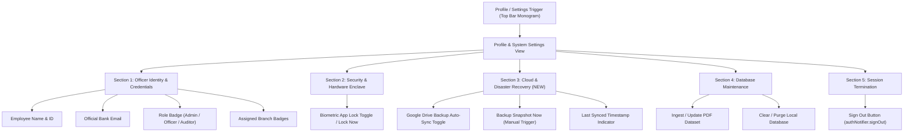

# Current UI Elements & Architecture Mapping

> **Purpose**: This document maps the existing presentation layer, widget hierarchy, navigation routes, and functional hooks of the Flutter application. It serves as an architectural blueprint before redesigning the UI to a minimal, high-contrast fintech aesthetic, ensuring that **zero Isar database logic, FastAPI authentication flows, or Riverpod state management behaviors are broken**.

---

## 1. Branch Section & Active Client Loan Records

The branch and client loan management system is currently distributed across four primary screens and routes.

### 1.1 Screen Breakdown & Widget Structure

#### A. Branch Overview / Unit Selection (`HomeDashboardScreen`)
- **File**: `lib/screens/home_dashboard_screen.dart`
- **Route**: `/` (`HomeDashboardScreen`)
- **Widget Hierarchy**:
  ```text
  BackgroundScaffold
  └── AppBar
      ├── Title: "CO-OP RECOVERY"
      └── Actions: [CircleAvatar -> PopupMenuButton (Profile & System Actions)]
  └── SafeArea -> Padding
      └── Column
          ├── Text: "Select Unit" (displayLarge, 34pt, w800)
          ├── Text: "Precision tracking for recovery operations." (bodyMedium)
          └── Expanded
              └── GridView.builder (maxCrossAxisExtent: 220, childAspectRatio: 0.9)
                  └── GlassCard (per Office / Branch)
                      └── Column
                          ├── Row
                          │   ├── Icon Container (Icons.grid_view_rounded)
                          │   └── IconButton (Icons.delete_sweep_outlined) -> _showDeleteBranchDialog
                          └── Column
                              ├── Text: branch.name
                              └── Row
                                  ├── GlassPill: "$employeeCount EMPLOYEES"
                                  └── Icon: Icons.arrow_right_alt_rounded
  └── FloatingActionButton (GlassPill: "ADD BRANCH") -> _showAddBranchModal
  ```
- **Interactions**:
  - Tapping a branch card triggers `context.push('/branch/${branch.id}')`.
  - Tapping delete icon triggers `_showDeleteBranchDialog` -> `ref.read(appStateProvider.notifier).deleteBranch(branch.id)`.
  - Tapping FAB triggers `_showAddBranchModal` -> `ref.read(appStateProvider.notifier).addBranch(name)`.

---

#### B. Branch Members & Portfolio Overview (`BranchDetailsScreen`)
- **File**: `lib/screens/branch_details_screen.dart`
- **Route**: `/branch/:id` (`BranchDetailsScreen(branchId: state.pathParameters['id']!)`)
- **Widget Hierarchy**:
  ```text
  BackgroundScaffold
  └── AppBar
      ├── Leading: Back IconButton -> context.pop()
      ├── Title: Text(office.name)
      └── Actions: [GlassPill: "Drafts" (Icons.description_outlined)] -> context.push('/branch/$branchId/drafts')
  └── SafeArea -> Padding
      └── Column
          ├── Row
          │   ├── Text: "Unit Members" (displayLarge, 30pt)
          │   └── GlassPill: "ADD" (Icons.person_add_alt_1_outlined) -> _showAddEmployeeModal
          └── Expanded
              └── customers.isEmpty
                  ? Center("No registered members in this unit.")
                  : ListView.builder
                      └── SizedBox(height: 140)
                          └── GlassCard (per Customer)
                              └── Column
                                  ├── Row
                                  │   ├── Avatar Container (Icons.person_outline_rounded)
                                  │   ├── Column [Text(customer.name), Text("ID: ${customer.memberNo}")]
                                  │   ├── IconButton (Icons.delete_outline) -> _showDeleteDialog
                                  │   └── GlassPill: "MANAGE" -> context.push('/customer/${customer.id}')
                                  ├── Divider
                                  └── Row (spaceAround)
                                      ├── _StatItem(label: 'LOANS', value: '${customerLoans.length}')
                                      └── _StatItem(label: 'OUTSTANDING', value: '₹${totalOs.toStringAsFixed(0)}')
  ```
- **Data Computations Per Item**:
  - `customerLoans = appState.loans.where((l) => l.customerId == customer.id).toList();`
  - `totalOs = customerLoans.fold(0.0, (sum, l) => sum + l.principalOutstanding);`

---

#### C. Active Client Loan Records Detail (`CustomerProfileScreen`)
- **File**: `lib/screens/customer_profile_screen.dart`
- **Route**: `/customer/:id` (`CustomerProfileScreen(customerId: state.pathParameters['id']!)`)
- **Widget Hierarchy**:
  ```text
  BackgroundScaffold
  └── AppBar
      ├── Leading: Back IconButton -> context.pop()
      └── Title: Text("Member Profile")
  └── FloatingActionButton (GlassPill: "NEW LOAN") -> _showAddLoanModal
  └── SafeArea -> Padding
      └── Column
          ├── Member Profile Header Card (GlassCard, height 110)
          │   └── Row
          │       ├── Avatar Container (Icons.person)
          │       └── Column
          │           ├── Text(customer.name)
          │           └── Text("${office.name} Unit · Member #${customer.memberNo}")
          ├── Text: "Financial Exposure" (displayLarge, 24pt)
          └── Expanded
              └── loans.isEmpty
                  ? Center("No active loan accounts found.")
                  : ListView.builder
                      └── SizedBox(height: 150)
                          └── GlassCard (per Loan)
                              └── Row
                                  ├── Column (flex/expanded)
                                  │   ├── Text("A/C ${loan.accountNo}")
                                  │   ├── _StatusPill(status: loan.status)
                                  │   └── Row
                                  │       ├── _LoanSmallStat(label: 'OUTSTANDING', value: '₹${loan.principalOutstanding}')
                                  │       └── _LoanSmallStat(label: 'BASE EMI', value: '₹${loan.baseEmiAmount}')
                                  └── Column
                                      ├── IconButton (Icons.delete_outline) -> _showDeleteLoanDialog
                                      └── GlassPill: "HISTORY"
  ```
- **Interactions**:
  - Delete loan: calls `ref.read(appStateProvider.notifier).deleteLoan(loan.id)`.
  - Add loan: calls `ref.read(appStateProvider.notifier).addLoan(customerId, accountNo, principalOS, baseEmi)`.

---

#### D. Aggregated Branch Collection Drafts (`MonthlyDraftsScreen`)
- **File**: `lib/screens/monthly_drafts_screen.dart`
- **Route**: `/branch/:id/drafts`
- **Widget Hierarchy**:
  ```text
  BackgroundScaffold
  └── AppBar
      ├── Leading: Back IconButton -> context.pop()
      ├── Title: Text("${office.name} Drafts")
      └── Actions: [GlassPill: "PDF PREVIEW"] -> context.push('/branch/$branchId/preview/$month/$year')
  └── SafeArea -> Padding
      └── Column
          ├── Row ["Monthly Collection", GlassPill: "GENERATE DRAFTS" / "REFRESH DRAFTS"]
          └── Expanded -> GlassCard
              └── Column
                  ├── Header: "Master Collection: $month/$year"
                  └── Expanded -> SingleChildScrollView (vertical & horizontal)
                      └── DataTable
                          ├── Columns: MEMBER, LOAN ACCOUNT, PRINCIPAL, INTEREST, PENAL, OTHERS, TOTAL, ADJUST
                          └── Rows: mapped from drafts
                              └── Edit Action Cell -> GlassPill: "EDIT" -> _showEditEmiDialog
  ```

---

### 1.2 UX Analysis & Recommendations for Organizing Active Loan Records

In the current architecture, viewing active client loan records incurs significant cognitive friction and fragmentation:

1. **Two-Hop Navigation Disconnect**:
   - Currently, a user on `BranchDetailsScreen` only sees aggregate loan counts and total outstanding balance per member. To see actual loan accounts (account numbers, status, base EMI), they must leave the branch context by tapping "MANAGE", navigating to a separate screen (`CustomerProfileScreen`).
   - **Fintech Recommendation**: Implement an **inline collapsible accordion or master-detail drawer** on the branch screen. Tapping a member row expands their active loan cards directly beneath them without leaving the branch screen, or opens a side inspector panel.

2. **Absence of Portfolio Metric Summary**:
   - The branch view lacks a top-level financial KPI banner (e.g., Total Principal at Risk, Total Monthly Recovery Target, Portfolio Health / NPA ratio).
   - **Fintech Recommendation**: Place a minimalist, high-contrast **KPI Ticker** at the top of the branch screen displaying:
     - Total Active Loans
     - Gross Principal Outstanding
     - Current Month Demand / Expected Collection
     - Defaulter / Overdue Count

3. **Lack of Filtering, Sorting, and Search**:
   - The current list renders all members in insertion order with no search by name or membership number, and no sorting by highest exposure.
   - **Fintech Recommendation**: Add a segmented control / filter pill bar:
     - `All Accounts` | `Active Only` | `Critical / Overdue` | `Zero Balance`
     - Quick alphanumeric search for Member Name, Membership ID, or Loan Account Number.
     - Sort by: Outstanding Balance (Descending), Member Name (A-Z), Account Number.

4. **Rigid Height Constraints**:
   - Both `BranchDetailsScreen` (`SizedBox(height: 140)`) and `CustomerProfileScreen` (`SizedBox(height: 150)`) enforce fixed container heights. On smaller screens or when device accessibility font scaling is enabled, text truncates or risks layout overflow.
   - **Fintech Recommendation**: Transition to intrinsic, content-driven auto-layout cards or dense tabular data rows with clean monospace financial figures.

---

## 2. Profile / Settings Section & Injection Targets

### 2.1 Current State Analysis
There is **no dedicated ProfileScreen or SettingsScreen** currently in the app. All user profile data, session management, and system maintenance triggers are concentrated inside a single dropdown menu on the `HomeDashboardScreen`:

- **Location**: `lib/screens/home_dashboard_screen.dart` (lines 79–202)
- **Trigger**: `AppBar.actions` -> `PopupMenuButton<String>` with a `CircleAvatar` displaying the employee's initial.
- **Current Menu Elements**:
  1. **Officer Details Header** (Disabled menu item):
     - Displays `authState.employee!.name`
     - Displays `authState.employee!.email`
     - Displays role pill: `authState.employee!.role.toUpperCase()`
  2. **Divider**
  3. **Value `'import_pdf'`**: Row with `Icons.picture_as_pdf_rounded` ("Import / Update PDF Data")
  4. **Value `'clear_db'`**: Row with `Icons.delete_forever_rounded` ("Clear Local Database")
  5. **Value `'lock'`**: Row with `Icons.fingerprint_rounded` ("Lock App (Biometrics)")
  6. **Divider**
  7. **Value `'logout'`**: Row with `Icons.logout` ("Sign Out", colored `Colors.redAccent`)

---

### 2.2 Injection Blueprint for New Fintech UI

To adhere to a minimal, high-contrast fintech aesthetic, these controls should be extracted into a dedicated **Profile & Security Settings Panel** (accessible via a dedicated top-right profile chip, modal bottom sheet, or distinct route `/settings`).



#### Detailed Injection Specifications:

1. **Employee Details Injection**:
   - **State Hook**: `ref.watch(authNotifierProvider).employee` (`AuthEmployee`).
   - **Data Fields to Bind**:
     - `employee.name`: Full official name (e.g., "Postal Recovery Officer").
     - `employee.email`: Verified email (e.g., "officer@keralabank.co.in").
     - `employee.role`: Authorization role badge (`"admin"`, `"officer"`, `"auditor"`).
     - `employee.id`: System officer UUID / ID code.
     - `employee.assignedBranches`: List of authorized branch codes (`List<String>`).
     - `employee.isActive`: Active verification status badge.
   - **UI Presentation**: High-contrast, sharp identity card with monochromatic avatar, uppercase typography, and monospaced ID tag.

2. **Google Drive Backup Toggle Injection**:
   - **Current Status**: Not yet present in existing code.
   - **Injection Target**: Dedicated "Cloud & Disaster Recovery" tile.
   - **UI Components Needed**:
     - `Switch` or custom high-contrast toggle: `Enable Automatic Cloud Backup`.
     - Status subtitle: `Last Synced: Not configured / Never`.
     - Action button: `Create Encrypted Backup Now`.
   - **Backend / Hook Integration**:
     - The existing `AuthService` already requests the Google profile & email scopes and manages Google Sign-In tokens. When implementing Drive backups, the Google Drive app-data scope (`https://www.googleapis.com/auth/drive.appdata` or `drive.file`) and an encrypted export of the local Isar database file (`default.isar`) can be tied directly to this toggle.

3. **Logout Button Injection**:
   - **Current Call**:
     ```dart
     ref.read(authNotifierProvider.notifier).signOut();
     ```
   - **Exact Execution Flow**:
     1. Transitions `authNotifierProvider` state to `AuthStatus.authenticating`.
     2. Calls `_authService.signOut()`, which disconnects Google Sign-In and clears all tokens in `FlutterSecureStorage` (`keyAuthToken`, `keyRefreshToken`, `keyCachedEmployee`).
     3. Sets state to `AuthStatus.unauthenticated`.
     4. `_AuthRouterListenable` notifies `GoRouter`, whose `redirect` guard immediately pushes the user to `/login`.
   - **UI Presentation**: High-contrast danger action button ("Sign Out of Officer Session") with a confirmation dialog.

4. **Biometric App Lock Injection**:
   - **Current Call**:
     ```dart
     ref.read(appLockProvider.notifier).lock();
     ```
   - Instantly brings up the full-screen `AppLockScreen` overlay backed by device biometrics.

---

## 3. Exact Function Calls, Providers & Functional Hooks

Every single provider, repository query, mutator method, and service call that **must remain unbroken** during the UI redesign is mapped below.

### 3.1 Central Data & Isar Layer (`lib/data/data_providers.dart`)

| UI Action | Hook / Method Call | Underlying Service / Repository Operation | Notes |
| :--- | :--- | :--- | :--- |
| **Watch App State** | `ref.watch(appStateProvider)` | Asynchronously loads `offices`, `customers`, `loans`, `monthlyRecoveries` from Isar | Returns `AsyncValue<AppState>`. Must handle `loading`, `error`, `data`. |
| **Add Unit / Branch** | `ref.read(appStateProvider.notifier).addBranch(name)` | `LoanLedgerService.createOffice(name: name)` -> `IsarOfficeRepository.saveOffice(...)` | Updates Riverpod state with newly created `Office`. |
| **Delete Unit / Branch** | `ref.read(appStateProvider.notifier).deleteBranch(officeId)` | `LoanLedgerService.deleteOfficeCascade(officeId)` -> Cascade deletes from Isar `Office`, `Customer`, `Loan`, `MonthlyRecovery` | Calls `ref.invalidateSelf()` to refresh all lists. |
| **Add Member** | `ref.read(appStateProvider.notifier).addEmployee(branchId, name, memberNo)` | `LoanLedgerService.registerCustomer(...)` -> `IsarCustomerRepository.saveCustomer(...)` | Updates Riverpod state with newly created `Customer`. |
| **Delete Member** | `ref.read(appStateProvider.notifier).deleteEmployee(customerId)` | `LoanLedgerService.deleteCustomerCascade(customerId)` -> Cascade deletes `Customer`, associated `Loan`s, and `MonthlyRecovery`s | Calls `ref.invalidateSelf()`. |
| **Add Loan Account** | `ref.read(appStateProvider.notifier).addLoan(customerId, accountNo, principalOS, baseEmi)` | `LoanLedgerService.initializeLoan(...)` -> `IsarLoanRepository.saveLoan(...)` | Updates Riverpod state with newly created `Loan`. |
| **Delete Loan Account** | `ref.read(appStateProvider.notifier).deleteLoan(loanId)` | `LoanLedgerService.deleteLoanCascade(loanId)` -> Cascade deletes `Loan` and associated `MonthlyRecovery`s | Calls `ref.invalidateSelf()`. |
| **Generate Monthly Drafts** | `ref.read(appStateProvider.notifier).generateDrafts(month, year, branchId: ...)` | `RecoveryEngine.generateDrafts(...)` -> computes EMI and saves drafts to `IsarRecoveryRepository` | Refreshes `monthlyRecoveries` in Riverpod state. Returns status message string. |
| **Adjust / Edit Draft EMI** | `ref.read(appStateProvider.notifier).updateDraft(draftId, principalDue: ..., interest: ..., penalInt: ..., others: ...)` | `RecoveryEngine.adjustRecoveryDraft(...)` -> updates record in `IsarRecoveryRepository` | Immutably updates the modified `MonthlyRecovery` inside `AppState`. |
| **Clear Local Database** | `ref.read(appStateProvider.notifier).clearDatabase()` | `DataSeederService.clearDatabase()` -> Wipes all 4 Isar collections (`monthlyRecoveryCollections`, `loanCollections`, `customerCollections`, `officeCollections`) | Calls `ref.invalidateSelf()`. |
| **Import / Ingest PDF Dataset** | `ref.read(appStateProvider.notifier).importDataFromJson(jsonString, wipeExisting: ..., conflictAction: ...)` | `DataSeederService.seedFromJsonString(...)` -> parses JSON and populates encrypted Isar database | Returns `SeederResult` (counts of offices, customers, loans). Calls `ref.invalidateSelf()`. |

---

### 3.2 Authentication & FastAPI Layer (`lib/core/auth/`)

| UI Action | Hook / Method Call | Backend / Storage Operation | Notes |
| :--- | :--- | :--- | :--- |
| **Watch Auth State** | `ref.watch(authNotifierProvider)` | Reads reactive `AuthState` (`status`, `employee`, `errorMessage`) | Governs session state, routing guards, and employee display. |
| **Google Sign-In** | `ref.read(authNotifierProvider.notifier).signInWithGoogle(...)` | 1. `GoogleSignIn.signIn()` obtains ID token.<br>2. `POST /auth/google-login` on FastAPI backend.<br>3. Saves JWT access/refresh tokens to `FlutterSecureStorage`.<br>4. Stores cached `AuthEmployee`. | Handles `GoogleSignInCanceledException`, `UnauthorizedEmployeeException` (403), `DeviceRevokedException` (401). |
| **Sign Out** | `ref.read(authNotifierProvider.notifier).signOut()` | 1. `GoogleSignIn.signOut()`<br>2. Clears secure storage (`keyAuthToken`, `keyRefreshToken`, `keyCachedEmployee`).<br>3. Sets state to `AuthStatus.unauthenticated`. | Triggers automatic GoRouter navigation to `/login`. |
| **Session Verification** | `ref.read(authNotifierProvider.notifier).checkExistingSession()` | 1. Checks secure storage for token.<br>2. Verifies session with `GET /auth/status`.<br>3. Auto-refreshes expired tokens via `POST /auth/refresh`. | Run on startup or app resume. |
| **Clear Auth Error** | `ref.read(authNotifierProvider.notifier).clearError()` | Resets transient error strings in `AuthState`. | Used when dismissing error banners. |

> [!NOTE]
> `AuthNotifier.bypassGoogleAuth` in `lib/core/auth/auth_providers.dart` is currently set to `true` for rapid local offline development with `defaultLocalOfficer`. The new UI must support both the bypassed local session and the live FastAPI Google OAuth session seamlessly.

---

### 3.3 Security, Encryption & App Lock Layer (`lib/core/security/`)

| UI Action | Hook / Method Call | Underlying Security Mechanism | Notes |
| :--- | :--- | :--- | :--- |
| **Watch Lock State** | `ref.watch(appLockProvider)` | Reads `bool` (`true` when locked, `false` when active) | Evaluated in `MyApp` (`lib/main.dart`) to render `AppLockScreen` overlay over all routes. |
| **Trigger Immediate Lock** | `ref.read(appLockProvider.notifier).lock()` | Sets `state = true` | Invoked from Settings/Profile or app background timeout. |
| **Unlock with Biometrics** | `ref.read(appLockProvider.notifier).authenticateAndUnlock()` | Calls `BiometricAuthService.authenticate()` via `local_auth` (Face ID / Touch ID / Device Passcode) | On success, sets `state = false`. |
| **Encryption Master Key** | `ref.watch(cipherServiceProvider.future)` | Loads/creates 256-bit AES master key in `FlutterSecureStorage`, initializes `CipherService` | Prerequisite in `AppStateNotifier.build()` before reading encrypted Isar records. |

---

### 3.4 Navigation & Route Hooks (`lib/main.dart`)

All routes are registered in `routerProvider` and must be preserved:

| Route Path | Associated Screen | Key Navigation Calls in UI |
| :--- | :--- | :--- |
| `/login` | `LoginScreen` | Redirected automatically if `!authState.isAuthenticated`. |
| `/` | `HomeDashboardScreen` | Navigated via `context.go('/')`. Root dashboard displaying all branches. |
| `/branch/:id` | `BranchDetailsScreen` | `context.push('/branch/${branch.id}')` |
| `/customer/:id` | `CustomerProfileScreen` | `context.push('/customer/${customer.id}')` |
| `/branch/:id/drafts` | `MonthlyDraftsScreen` | `context.push('/branch/$branchId/drafts')` |
| `/branch/:id/preview/:month/:year` | `PdfPreviewScreen` | `context.push('/branch/$branchId/preview/$month/$year')` |

---

## 4. Preservation Checklist for the UI Redesign

To ensure complete functional and data integrity during the redesign:

- [ ] **Do NOT touch Isar schemas or database collections**: `OfficeCollection`, `CustomerCollection`, `LoanCollection`, `MonthlyRecoveryCollection` must remain unaltered.
- [ ] **Do NOT change Riverpod provider contracts**: Keep `appStateProvider`, `authNotifierProvider`, `appLockProvider`, and `cipherServiceProvider` method signatures intact.
- [ ] **Preserve Cascade Deletions**: Always call `deleteBranch`, `deleteEmployee`, and `deleteLoan` through `appStateProvider.notifier` so that downstream customer, loan, and recovery records are purged properly.
- [ ] **Preserve GoRouter Route Hierarchy**: Maintain existing route paths (`/`, `/branch/:id`, `/customer/:id`, etc.) or introduce new routes (e.g., `/settings`) additively without modifying existing route parameters.
- [ ] **Preserve Auth Router Listenable**: The redirect logic in `_AuthRouterListenable` must continue monitoring `authNotifierProvider` to guard protected routes against unauthenticated or revoked states.

