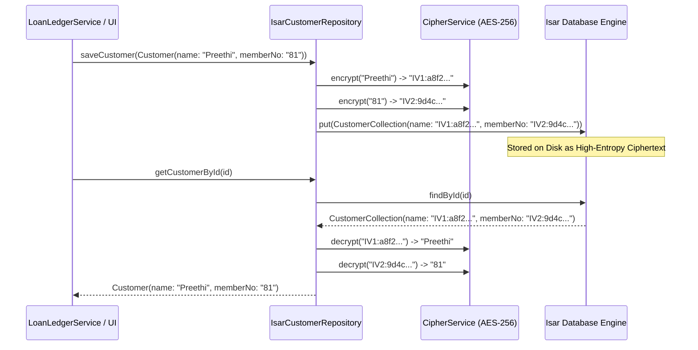

# Local-First Architecture Migration Plan
## Secure, Offline-First Loan Ledger System with Google Auth, Biometrics, Encrypted Isar DB, Google Drive Backup & Local P2P Handover

> **Document Version:** 2.0.0  
> **Status:** Proposal / Pending Approval  
> **Target Date:** November 2026  
> **Author:** Expert System Architect & Senior Flutter/Python Developer  

---

## Table of Contents
1. [Executive Summary & Core Directives](#1-executive-summary--core-directives)
2. [Target System Architecture](#2-target-system-architecture)
3. [Security Architecture & Cryptographic Standards](#3-security-architecture--cryptographic-standards)
4. [Phased Implementation Roadmap](#4-phased-implementation-roadmap)
   - [Phase 1: Security Foundation (Biometrics, Secure Storage, AES-256 Encryption)](#phase-1-security-foundation-biometrics-secure-storage-aes-256-encryption)
   - [Phase 2: Identity & Backend (Google Sign-In, FastAPI ID Token Verification, Custom JWT)](#phase-2-identity--backend-google-sign-in-fastapi-id-token-verification-custom-jwt)
   - [Phase 3: Local Database & UI Integration (Isar Schemas, Transparent Repository Encryption)](#phase-3-local-database--ui-integration-isar-schemas-transparent-repository-encryption)
   - [Phase 4: Cloud Sync & Backup (Google Drive `appdata`, Snapshotting, Restore Logic)](#phase-4-cloud-sync--backup-google-drive-appdata-snapshotting-restore-logic)
   - [Phase 5: Secure Handover Protocol (Local Network/Bluetooth Code-Gated Transfer)](#phase-5-secure-handover-protocol-local-networkbluetooth-code-gated-transfer)
5. [Threat Modeling & Mitigation Matrix](#5-threat-modeling--mitigation-matrix)
6. [Deliverables & Definition of Done](#6-deliverables--definition-of-done)
7. [Approval & Execution Gate](#7-approval--execution-gate)

---

## 1. Executive Summary & Core Directives

The objective of this project is to transition the **Loan Recovery & Ledger System** from a conventional client-server model to a **hardened, Local-First, zero-trust architecture**.

### Core Directives:
1. **100% Offline Capability:** All ledger operations (branch rosters, customer accounts, loan ledgers, monthly interest calculations, and statutory 11-column PDF generation) execute entirely on-device without internet access.
2. **Google Identity Verification:** Authentication is delegated to Google Sign-In. A lightweight Python (FastAPI) service verifies Google-issued ID tokens against an internal database of authorized postal/society employees, generates custom JWTs, and enforces remote access revocation.
3. **Hardware-Backed Device Security:** Physical app access is gated by biometrics/PIN via `local_auth`. Encryption keys reside in the device's hardware security module (Keychain on iOS, Keystore on Android) via `flutter_secure_storage`.
4. **Field-Level AES Encryption:** Sensitive PII and financial numbers (member names, loan balances, base EMIs, recovery amounts) are encrypted at rest using AES-256 via the `encrypt` package before touching the local Isar database.
5. **Private Cloud Disaster Recovery:** Automated, encrypted database file snapshots backed up to Google Drive's hidden `drive.appdata` folder (identical to WhatsApp's backup model).
6. **Code-Gated Local Peer Handover:** A secure, ephemeral protocol enabling an authorized employee to transfer encrypted branch records to a peer officer over the local network / Wi-Fi Direct / Bluetooth via a temporary one-time pairing code.

---

## 2. Target System Architecture

```mermaid
flowchart TD
    subgraph Mobile_Device["Flutter Client (100% Local-First Engine)"]
        UI["Presentation Layer\n(Screens, Glass Widgets, PDF Service)"]
        BioLock["Biometric Gatekeeper\n(local_auth + AppLifecycleListener)"]
        SecStorage["Hardware Secure Storage\n(flutter_secure_storage)"]
        CipherService["AES-256 Field & Payload Cipher\n(encrypt package)"]
        IsarDB[("Local Isar Database\n(Encrypted Fields at Rest)")]
        Repositories["Transparent Repositories\n(IsarOffice, Customer, Loan, Recovery)"]
        DomainServices["Domain Engine\n(RecoveryEngine, LoanLedgerService)"]
        DriveBackupService["Drive Backup & Snapshot Engine\n(googleapis + drive.appdata)"]
        LocalP2PService["Local P2P Handover Service\n(Local Socket / mDNS / Bluetooth)"]

        UI --> BioLock
        BioLock -.->|Unlocks Key| SecStorage
        SecStorage -->|Supplies Master Key| CipherService
        UI --> DomainServices
        DomainServices --> Repositories
        Repositories <--> CipherService
        CipherService <--> IsarDB
        IsarDB <--> DriveBackupService
        IsarDB <--> LocalP2PService
    end

    subgraph Identity_Server["Lightweight Cloud Backend (FastAPI on Render)"]
        AuthRouter["FastAPI Auth Router\n(/auth/google-login, /auth/revoke)"]
        TokenVerifier["Google Auth SDK\n(verify_oauth2_token)"]
        AuthorizedDB[("Authorized Employees DB\n(PostgreSQL / SQLite)")]
        RevocationRegistry[("Revocation Blacklist / Sessions")]

        AuthRouter --> TokenVerifier
        AuthRouter --> AuthorizedDB
        AuthRouter --> RevocationRegistry
    end

    subgraph Google_Ecosystem["Google Cloud Infrastructure"]
        GoogleOAuth["Google Identity Services (OAuth2)"]
        DriveAppData[("Google Drive appdata Folder\n(Hidden Private Snapshots)")]
    end

    subgraph Peer_Device["Peer Employee Device (Receiver)"]
        PeerApp["Local Flutter Client (Receiver)"]
    end

    %% Network flows
    Mobile_Device <==>|1. Sign-In with Google (ID Token)| GoogleOAuth
    Mobile_Device <==>|2. Exchange ID Token for Custom JWT| AuthRouter
    Mobile_Device <==>|3. Periodically Check Revocation Status| AuthRouter
    DriveBackupService <==>|4. Upload / Restore Encrypted DB Snapshot| DriveAppData
    LocalP2PService <==>|5. Code-Gated P2P Handover (Local Network/BT)| PeerApp
```

---

## 3. Security Architecture & Cryptographic Standards

### 3.1. Cryptographic Specifications
| Parameter | Standard | Implementation Detail |
| :--- | :--- | :--- |
| **Field Cipher** | AES-256-CBC | Randomized 128-bit IV per field/record via `encrypt` package. |
| **Ciphertext Format** | `<base64_iv>:<base64_ciphertext>` | Prevents IV reuse and guarantees freshness on updates. |
| **Master Key Generation** | 256-bit Secure Random | Generated on device using `Random.secure()`, never leaves device. |
| **Master Key Storage** | Hardware Security Module | iOS Keychain (`kSecAttrAccessibleWhenUnlockedThisDeviceOnly`), Android Keystore (`EncryptedSharedPreferences`). |
| **Google Auth Flow** | OpenID Connect (OIDC) | Google Sign-In yields Google ID Token $\to$ Backend verifies signature using Google's public JWKS certs. |
| **Backend JWT** | HS256 / RS256 | Signed by FastAPI secret; 15-minute access token + 30-day rotating refresh tokens. |
| **Cloud Backup Cipher** | Gzip + AES-256-GCM | Database files compacted, gzipped, encrypted with user's backup key before upload to Google Drive `appdata`. |
| **P2P Handover Cipher** | PBKDF2 + AES-256-GCM | Ephemeral key derived from a 6-digit numeric OTP + salt (100,000 rounds of HMAC-SHA256), 10-minute TTL. |

---

## 4. Phased Implementation Roadmap

---

### Phase 1: Security Foundation (Biometrics, Secure Storage, AES Encryption Setup)
*Objective: Build the on-device cryptographic foundation and physical access controls before touching domain records.*

#### 1. Tasks & Components:
1. **Dependencies (`pubspec.yaml`):**
   - `local_auth: ^2.3.0` (biometric and device PIN authentication)
   - `flutter_secure_storage: ^9.2.2` (hardware-backed key storage)
   - `encrypt: ^5.0.3` (AES-256 cipher implementation)
   - `crypto: ^3.0.6` (hashing, random bytes generation)
2. **Secure Key Manager (`lib/core/security/secure_storage_service.dart`):**
   - Automatically initializes a 256-bit AES master key if one does not exist.
   - Manages secure flags (biometric enabled, device enrolled, session tokens).
3. **Cipher Service (`lib/core/security/cipher_service.dart`):**
   - Encrypts/decrypts strings, integers, and floating-point values using AES-256.
   - Formats outputs as standard `<iv>:<ciphertext>` strings.
   - Provides safe fallback and error handling for corrupted ciphertext.
4. **Biometric Gatekeeper (`lib/core/security/biometric_auth_service.dart`):**
   - Detects hardware capabilities (`canCheckBiometrics`, `isDeviceSupported`).
   - Authenticates user via Fingerprint / FaceID / Device Passcode with localized prompt: `"Authenticate to access Co-operative Loan Recovery System"`.
5. **App Lifecycle Lock Observer (`lib/core/security/app_lock_manager.dart`):**
   - Hooks into `WidgetsBindingObserver` / `AppLifecycleListener`.
   - Automatically activates app lock when app transitions to `paused` or `detached`.
   - Configurable grace period (e.g. 30 seconds for quick task-switching).
6. **Lock Overlay UI (`lib/screens/security/app_lock_screen.dart`):**
   - Cinematic frosted glass security screen hiding confidential financial data from the OS multitasking snapshot.
   - "Unlock with Biometrics" action triggering device authentication.

#### 2. Verification & Testing:
- Unit tests: AES encryption/decryption round-trip testing on strings, doubles, and JSON payloads.
- Secure storage test: Verifying key generation and retrieval persistence across re-instantiation.
- Lifecycle test: Simulating app backgrounding and verifying that `AppLockManager` triggers the lock state.

---

### Phase 2: Identity & Backend (Google Sign-In, FastAPI ID Token Verification, Custom JWT)
*Objective: Establish a lightweight Python authentication gateway that verifies Google ID tokens, checks an employee whitelist, issues custom JWTs, and handles remote device revocation.*

#### 1. Backend Tasks (`backend/`):
1. **Dependencies (`backend/requirements.txt`):**
   - `fastapi`, `uvicorn[standard]`, `google-auth`, `pyjwt`, `pydantic`, `sqlalchemy`, `psycopg2-binary`.
2. **Database Models (`backend/models.py`):**
   - `AuthorizedEmployee`:
     - `id` (`VARCHAR`, PK)
     - `email` (`VARCHAR`, unique, indexed) - Authorized employee Gmail/Google Workspace address
     - `name` (`VARCHAR`)
     - `role` (`VARCHAR`: `officer`, `auditor`, `admin`)
     - `assigned_branches` (`JSON` array of authorized branch slugs, e.g. `["punalur", "adoor"]`)
     - `is_active` (`BOOLEAN`, default `True`)
   - `DeviceSession`:
     - `id` (`VARCHAR`, PK)
     - `employee_id` (`VARCHAR`, FK $\to$ `AuthorizedEmployee.id`)
     - `device_id` (`VARCHAR`, indexed) - Unique client device fingerprint
     - `device_name` (`VARCHAR`)
     - `refresh_token_hash` (`VARCHAR`)
     - `is_revoked` (`BOOLEAN`, default `False`)
     - `last_seen_at` (`TIMESTAMP`)
3. **Google ID Token Verification (`backend/auth_service.py`):**
   - Uses `google.oauth2.id_token.verify_oauth2_token()` with client ID validation.
   - Extracts Google verified profile (`email`, `sub`, `name`, `picture`).
   - Rejects unverified emails or unauthorized employees not present in `authorized_employees`.
4. **JWT Generation & Revocation Engine (`backend/jwt_handler.py`):**
   - Issues short-lived access tokens (15 minutes) with custom claims (`employee_id`, `email`, `role`, `device_id`).
   - Issues rotating refresh tokens (30 days).
   - Middleware dependency `get_current_active_employee()` that verifies token validity and checks `DeviceSession.is_revoked`.
5. **API Endpoints (`backend/main.py`):**
   - `POST /auth/google-login`: Takes Google `id_token` and client `device_id`. Verifies token, validates employee status, registers session, returns custom JWT pair.
   - `POST /auth/refresh`: Exchanges refresh token for new access token (validates non-revocation).
   - `POST /auth/revoke-device`: Admin endpoint to immediately blacklist a device session or employee (remote wipe/kill switch).
   - `GET /auth/status`: Heartbeat endpoint returning authorization state and active branch permissions.

#### 2. Flutter Client Tasks:
1. **Dependencies:** `google_sign_in: ^6.2.2`, `dio: ^5.9.2`.
2. **Auth Service (`lib/core/auth/auth_service.dart`):**
   - Triggers native Google Sign-In prompt.
   - Obtains Google `idToken`.
   - Transmits `idToken` + unique `deviceId` to FastAPI `/auth/google-login`.
   - Stores custom JWT and refresh token in `flutter_secure_storage`.
3. **Dio Auth Interceptor (`lib/data/auth_interceptor.dart`):**
   - Automatically injects `Authorization: Bearer <custom_jwt>`.
   - Catches 401 Unauthorized responses to perform automatic refresh token rotation.
   - If device is marked revoked by backend, wipes local tokens and displays lockout notice.
4. **Login Screen (`lib/screens/auth/login_screen.dart`):**
   - Glassmorphic Google Sign-In screen with official society branding.

#### 3. Verification & Testing:
- Test Google ID token verification against simulated tokens and valid Google tokens.
- Verify whitelist check: unauthorized Google accounts receive `403 Forbidden ("Employee not authorized")`.
- Verify revocation: marking a session revoked immediately blocks API requests and locks client access.

---

### Phase 3: Local Database & UI Integration (Isar Schemas, Transparent Repository Encryption)
*Objective: Upgrade our existing local Isar database architecture to transparently encrypt sensitive personal and financial data at rest without altering any domain calculation logic.*

#### 1. Architectural Strategy:
Domain models (`lib/domain/models/`) and financial algorithms (`RecoveryEngine`, `LoanLedgerService`) continue to work with raw numbers and strings in memory. **Encryption is strictly applied at the Isar collection boundary**:



#### 2. Tasks & Schema Refactoring:
1. **Schema Updates (`lib/data/local/schemas/`):**
   - `CustomerCollection`:
     - `String name` (encrypted string)
     - `String memberNo` (encrypted string)
     - `String officeId` (indexed UUID string, unencrypted for fast relational filtering)
   - `LoanCollection`:
     - `String accountNo` (encrypted string)
     - `String principalOutstandingEncrypted` (encrypted string representation of double)
     - `String baseEmiAmountEncrypted` (encrypted string representation of double)
     - `String status` (indexed plaintext string: `Active`, `Closed`)
     - `String customerId` (indexed UUID string)
   - `MonthlyRecoveryCollection`:
     - `String principalDueEncrypted` (encrypted double)
     - `String interestEncrypted` (encrypted double)
     - `String penalInterestEncrypted` (encrypted double)
     - `String otherChargesEncrypted` (encrypted double)
     - `int month`, `int year`, `String loanId` (indexed composite keys for $O(1)$ idempotency queries)
2. **Code Generation:**
   - Execute `dart run build_runner build --delete-conflicting-outputs` to generate updated `.g.dart` adapters.
3. **Repository Refactoring (`lib/data/repositories/`):**
   - Inject `CipherService` into `IsarOfficeRepository`, `IsarCustomerRepository`, `IsarLoanRepository`, and `IsarRecoveryRepository`.
   - Handle transparent encryption in `toCollection()` / `fromDomain()` and decryption in `toDomain()`.
4. **Wire to Existing Presentation Layer:**
   - Verify that `AppStateNotifier` in `lib/data/data_providers.dart` seamlessly passes decrypted entities to screens (`HomeDashboardScreen`, `BranchDetailsScreen`, `MonthlyDraftsScreen`, `PdfPreviewScreen`).

#### 3. Verification & Testing:
- Inspect the physical `.isar` database file on disk to confirm that member names, loan balances, and amounts contain no plaintext strings or numbers.
- Run all existing unit tests in `test/domain/` to guarantee that financial formulas (1% interest, EMI decomposition, statutory notice generation) continue to pass with 100% precision.

---

### Phase 4: Cloud Sync & Backup (Google Drive `appdata`, Snapshotting, Restore Logic)
*Objective: Implement an automated, secure cloud backup and restore mechanism utilizing Google Drive's hidden application data folder (`drive.appdata`).*

#### 1. Tasks & Components:
1. **Dependencies:**
   - `googleapis: ^13.2.0` (official Google Drive v3 API client)
   - `archive: ^4.0.2` (in-memory compression and archive packaging)
2. **Drive Scope Configuration:**
   - OAuth2 Scope: `https://www.googleapis.com/auth/drive.appdata`.
   - *Security Benefit:* Files stored in `appdata` are completely hidden from the user's Google Drive UI, cannot be modified or deleted by other cloud apps, and are strictly sandboxed to this application.
3. **Database File Snapshot Engine (`lib/core/backup/database_snapshot_service.dart`):**
   - Flushes and compacts the active Isar database.
   - Packages `default.isar` and metadata into a tarball (`.tar.gz`).
   - Computes SHA-256 checksum for integrity verification.
   - Encrypts the entire snapshot bundle with an AES-256 backup key derived from the employee's master key + biometric confirmation.
4. **Google Drive Backup Service (`lib/core/backup/google_drive_backup_service.dart`):**
   - `uploadBackup()`:
     - Connects via authenticated Google client.
     - Uploads encrypted bundle with filename format: `loan_recovery_backup_<timestamp>_<device_id>.enc`.
     - Tags metadata: app version, total branches, total members, record checksum.
     - Prunes oldest snapshots (retaining latest 5 snapshots).
   - `listBackups()`: Queries `drive.appdata` for available recovery points.
   - `restoreBackup(fileId)`:
     - Downloads encrypted snapshot from Google Drive.
     - Verifies SHA-256 checksum against metadata.
     - Decrypts bundle using master key.
     - Safely closes active Isar instance, unpacks database files into app documents directory, and reopens Isar.
     - Triggers Riverpod `AppStateNotifier` refresh to reflect restored data immediately.
5. **Backup & Disaster Recovery Screen (`lib/screens/settings/backup_screen.dart`):**
   - Displays Google account status, last backup timestamp, and storage size.
   - "Back Up Now" action with animated progress indicator.
   - List of previous cloud snapshots with "Restore" confirmation dialog.

#### 2. Verification & Testing:
- Integration test: Take a snapshot of a populated local Isar database, upload to Google Drive `appdata`, simulate app re-install, restore snapshot, and assert all branches/loans are identical.
- Tamper test: Corrupt a single byte of the snapshot and verify that the restore process detects checksum mismatch and aborts safely without corrupting local data.

---

### Phase 5: Secure Handover Protocol (Local Network/Bluetooth Code-Gated Transfer)
*Objective: Allow an authorized officer to transfer client records for a specific branch (or entire database) to another authorized officer's device over local network (Wi-Fi) or Bluetooth using a temporary 6-digit security code.*

#### 1. Protocol Architecture (Zero Cloud Storage of Customer Data):
The handover operates peer-to-peer over the local network / Wi-Fi / Bluetooth. The cloud server acts **only as an identity verifier and signaling channel** — never storing customer ledger data:

```mermaid
sequenceDiagram
    autonumber
    participant OfficerA as Officer A (Sender Device)
    participant Relay as FastAPI Signaling Gateway
    participant OfficerB as Officer B (Receiver Device)

    OfficerA->>OfficerA: 1. Selects branch (e.g., Punalur) & taps "Initiate Handover"
    OfficerA->>OfficerA: 2. Generates random 6-digit PIN (e.g., 842109) & ephemeral Salt
    OfficerA->>OfficerA: 3. Derives 256-bit Key (K_temp) via PBKDF2(PIN, Salt)
    OfficerA->>OfficerA: 4. Exports branch data & encrypts with K_temp (AES-GCM)
    OfficerA->>OfficerA: 5. Starts local HTTP Server / Bluetooth GATT service
    OfficerA->>Relay: 6. Announces session: {session_id: "HO-5921", sender_email, salt, local_ip_or_bt_id}
    
    Note over OfficerA,OfficerB: Officer A verbally shares Session ID ("HO-5921") & PIN ("842109") with Officer B
    
    OfficerB->>Relay: 7. Authenticates as authorized employee & requests Session "HO-5921"
    Relay-->>OfficerB: 8. Validates Officer B role & returns {salt, local_ip_or_bt_id}
    OfficerB->>OfficerA: 9. Connects directly to Officer A (Local Socket / Bluetooth)
    OfficerA-->>OfficerB: 10. Transfers encrypted ciphertext payload
    OfficerB->>OfficerB: 11. Derives K_temp from Officer B's entered PIN + Salt
    OfficerB->>OfficerB: 12. Decrypts payload & performs batch upsert into local Isar DB
    OfficerB->>Relay: 13. Reports Handover Complete
    Relay->>OfficerA: 14. Handover Acknowledged; Officer A closes local server & invalidates PIN
```

#### 2. Tasks & Components:
1. **Dependencies:**
   - `network_info_plus: ^5.0.1` (detects local Wi-Fi IP and subnet)
   - `shelf: ^1.4.2` & `shelf_router` (ultra-lightweight embedded HTTP server running on sender device)
   - `qr_flutter: ^4.1.0` & `mobile_scanner: ^5.2.3` (optional visual QR code pairing containing session connection details)
2. **Ephemeral Crypto Engine (`lib/core/handover/handover_crypto.dart`):**
   - Generates cryptographically secure 6-digit numeric pairing code.
   - Derives ephemeral 256-bit AES key using PBKDF2 with 100,000 iterations of HMAC-SHA256 and a 16-byte random salt.
   - 10-minute countdown timer: key and local server self-destruct upon expiry.
3. **Handover Sender Service (`lib/core/handover/handover_sender_service.dart`):**
   - Filters Isar database for records linked to the selected branch.
   - Serializes and encrypts payload with the ephemeral key.
   - Binds a temporary local HTTP socket on an ephemeral port.
   - Registers session with FastAPI `/handover/announce`.
4. **Handover Receiver Service (`lib/core/handover/handover_receiver_service.dart`):**
   - Connects to local IP address or scans sender's QR code.
   - Downloads encrypted payload over local network.
   - Derives decryption key from the entered 6-digit PIN.
   - Atomically inserts records into receiver's local Isar database.
5. **Handover UI Flow (`lib/screens/handover/`):**
   - `HandoverSendScreen`: Branch selection, generated 6-digit code, animated countdown timer, QR code display.
   - `HandoverReceiveScreen`: Session code input, PIN entry pad, transfer progress bar, and success summary.

#### 3. Verification & Testing:
- Local transfer test: Transfer 1 branch with 50 members and 80 loans between two devices on the same Wi-Fi network; verify complete record integrity on receiver.
- Invalid PIN test: Submitting an incorrect 6-digit PIN fails AES-GCM tag verification, aborts transaction, and makes zero modifications to receiver's database.
- Expiration test: Verify that transfer attempts after 10 minutes are refused.

---

## 5. Threat Modeling & Mitigation Matrix

| Threat Vector | Attack Scenario | Architectural Mitigation |
| :--- | :--- | :--- |
| **Lost or Stolen Device** | Malicious actor obtains physical phone and attempts forensic extraction. | Database is AES-256 encrypted at rest. Master key is locked behind device Keystore/Keychain and requires biometric authentication. App auto-locks on resume. |
| **Dismissed Employee** | Former officer attempts to open app or dump customer loan data after dismissal. | Admin triggers remote revocation on FastAPI. The moment client connects or executes daily check, JWT is rejected, device session is killed, and local access is locked. |
| **Cloud Storage Breach** | Google Drive credentials compromised. | Backup files in `drive.appdata` are pre-encrypted with client-side AES-256 before upload. Google stores only opaque ciphertext. |
| **Man-in-the-Middle on Handover** | Attacker on same Wi-Fi network sniffs handover traffic. | Payload is encrypted with an ephemeral key derived from the out-of-band 6-digit PIN via PBKDF2. Traffic over local network is fully encrypted. |
| **Data Corruption on Restore** | Incomplete download or interrupted restore corrupts local database. | Restores are validated via SHA-256 checksums before unpacking. Original database is backed up to a temporary rollback copy before replacement. |

---

## 6. Deliverables & Definition of Done

| Phase | Milestone Name | Definition of Done |
| :---: | :--- | :--- |
| **Phase 1** | Security Foundation | `local_auth` active with `AppLifecycleListener` lock; `flutter_secure_storage` master key operational; `CipherService` passing 100% of AES-256 unit tests. |
| **Phase 2** | Identity & Backend | FastAPI Google ID token verification operational; custom JWT issuance working; unauthorized emails blocked; Flutter login screen functional. |
| **Phase 3** | Encrypted Isar DB | Isar collections updated with encrypted sensitive fields; transparent repositories passing all unit & integration tests; raw `.isar` file verified free of plaintext. |
| **Phase 4** | Google Drive Backup | Encrypted snapshot generation, compression, upload to `drive.appdata`, and full clean-install restore flow tested and functional. |
| **Phase 5** | Secure Handover | 6-digit code local P2P transfer between two devices working end-to-end with 10-minute expiry and PBKDF2 ephemeral encryption. |

---

## 7. Approval & Execution Gate

This implementation plan establishes a bank-grade, fully compliant, local-first operational platform. All existing Python files and working features remain intact as fallback.

We are ready to proceed with **Phase 1: Security Foundation (Biometrics, Secure Storage, and AES Encryption Setup)**.

**Awaiting your explicit approval to begin generating the code for Phase 1.**
